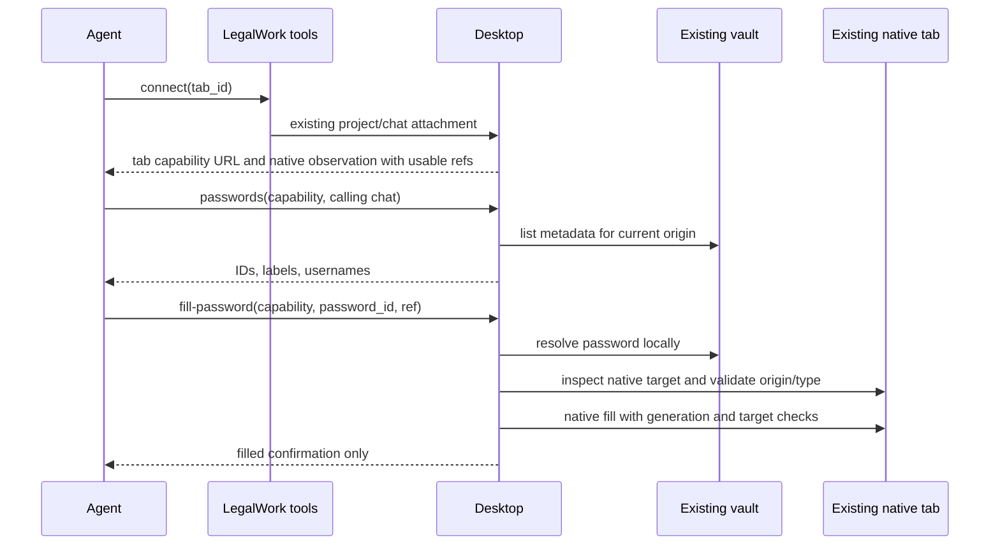

# Browser passwords: first version

LegalWork stores website passwords in its existing encrypted vault and fills them in the agent's existing native v2 browser tab. There is no private login session, new browser partition or cookie transfer. Users can continue using the same tab. Turn completion retains undismissed background tabs and their project/chat ownership; an explicit user dismissal still closes them when active work ends.

This is a fill-by-reference feature, not a confidentiality boundary against the agent. Unrestricted host commands retain their existing access to the vault and key. Browser evaluation and page scripts can still read a filled field. Network diagnostics and host execution permissions are unchanged. The narrower guarantee is that the password does not enter the fill tool's model-facing arguments or results.

## Storage and settings

`BrowserPasswordStore` uses a namespaced entry in `OAuthVault`, alongside OAuth/connector credentials. The existing vault format, AES-GCM encryption, key source, permissions and module write lock remain unchanged. An outer namespace lock serializes read-modify-write operations without replacing other vault consumers' entries. No browser password becomes an environment variable.

The record contains an opaque UUID, label, exact origin, optional username, password and update timestamp. Management routes require the existing host token:

| Method | Path | Result |
| --- | --- | --- |
| GET | `/browser-passwords[?origin=…]` | Metadata only; optional website filter uses the same domain matcher |
| PUT | `/browser-passwords` | Create/update; metadata only |
| DELETE | `/browser-passwords/:id` | Remove saved entry |

There is no API operation to return a password. Settings submits a value only when creating/replacing it. An empty password on edit retains the existing value; changing to a different website requires re-entering it. The user may save HTTPS origins; localhost HTTP supports development fixtures. URL paths are discarded. Matching uses the registrable domain from `tldts` with private public-suffix rules: the main domain and its subdomains share entries, while independently owned tenants such as `a.github.io` and `b.github.io` remain separate. Schemes and ports must match; IP addresses and hosts without a registrable domain match exactly. Existing saved records use this matching immediately without a vault migration. This first version is local desktop only.

## Inline credential request

When a login is needed and the current website has no saved entry, `legalwork_browser_request_password` creates a native v2 form and waits for its reply. The website comes from the desktop capability's current tab, not an agent-supplied URL. If a matching entry already exists, the tool returns its metadata without showing a card.

The native form contains only canonical website, label and optional username metadata, plus hidden saved-entry ID and cancellation fields. The conversation renders the credential card through `NativeFormPanel`, outside the composer. It shares `InlineCard`, its header and its footer with the existing email draft UI, using the same bounded width, compact field rows and action placement. Its password stays in local component state and is sent directly to the existing host-token vault API; it is never a question answer, tool argument, query/mutation-cache value or chat message. Saving clears the input and replies to the native form with only the saved UUID. Cancel replies with a cancellation flag and stops this login attempt. No new storage format, partition or vault-access rule is introduced.

The tool subscribes to native HTTP SSE before creating the form, then reads authoritative form state when notified. The HTTP stream's initial `server.connected` confirms subscription; the plugin's live-only event stream has no such handshake. It uses the existing project/session-admitted native API through LegalWork's proxy because the plugin's session domain does not expose forms. Stop cancels any pending form and closes the subscription. A pending card survives renderer reloads through ordinary native-form sync; if saving completed before a reply failed, the card lists the matching saved entry so the user can continue without entering the password again. Before returning verified metadata, the tool rechecks the current tab against the vault's domain matcher, including legitimate main-domain/auth-subdomain redirects. If a reload revoked the old browser capability, the tool instead returns the reference with `reconnect_required`: the agent must reopen the website, list matching entries and inspect fresh refs without asking the user to re-enter the password. This reference alone authorizes no fill; the existing desktop capability and target checks still apply.

## Agent and desktop flow

`legalwork_browser_passwords` and `legalwork_browser_fill_password` use the existing tab capability broker. Both pass through the existing effective browser network policy. The broker requires the exact owning chat's session header and a live grant. A remote attachment does not receive password actions, and the tools refuse to forward these operations through the manual-server extension gateway.

The desktop resolves the vault value only after admission. It checks the current top-level website and every native target resource website using the same store matcher, then verifies that the referenced element is an enabled password input. Native generation and target checks reject a document/frame change between inspection and execution. A second current-origin check precedes dispatch. The existing native fill implementation performs the insertion without sending the value through the OpenCode Tool RPC. It does not submit the form, take a screenshot, or return a page observation. Native errors are replaced with a fixed message so a page exception cannot echo the password into the result. Website mismatches get a distinct fixed diagnostic, preserved by the agent tool instead of a generic HTTP 400. Listing returns the website actually checked after redirects alongside matching metadata. Cancellation is propagated and uncertain actions are never replayed automatically.

These checks prevent accidental filling into an unrelated site, frame or stale target. They do not protect against a malicious script on an authorized website or an agent intentionally retrieving the value through unrestricted tools. A stronger isolation design would require a separately agreed scope.

## Validation

Store/route tests cover encryption, metadata-only results, concurrent edits, coexistence with other vault consumers, exact origins, replacement/deletion, host-token route declarations and write gates. Broker/tool tests cover exact chat identity, local-only admission and ID/ref-only requests. Desktop tests cover origin/frame/type rejection, cancellation and error sanitization.

`pnpm --filter @legalwork/desktop test:browser-passwords` uses synthetic credentials and an isolated vault/profile in a hidden Electron window. It exercises the real native controller and capability broker, checks the actual field value, confirms normal snapshots do not echo it, verifies explicit browser readback remains available, and rejects a stale ref after navigation. It makes no model calls and proves the insertion path, not real-model login quality. Build the server first with `pnpm --filter legalwork-server build`; standalone TypeScript emission does not produce all required runtime bundles.

`LEGALWORK_TEST_OPENCODE_BIN=/absolute/path/to/opencode pnpm --filter @legalwork/desktop test:browser-opening` starts a separate released v2 engine and actual panel IPC in hidden Electron. It proves opening refs work directly through native tools, reconnecting refreshes refs, another chat cannot connect, and username/vault-password/submission compose without an intermediate snapshot. This fixture uses native evaluation on the observed submit button because fully hidden macOS mouse capture requires a compositor surface. It uses synthetic credentials and zero inference calls.

The [native workflow acceptance record](pr-evidence/browser-passwords/native-workflow-verification.json) contains three actual agent runs through the development app, normal dispatch, saved test credentials and local synthetic websites: a single-page login, a two-step login and a company search. All produced the server-verified result with no argument-schema errors. The single-page password fill completed in three tool rounds and 13.9 seconds, using opening refs without another snapshot. Complete login still required 15 rounds and 132–133 seconds because background native click errors and keyboard replacement during recovery caused additional work; the search took six rounds and 26 seconds. This is not a matched before/after DeepL benchmark or proof of a three/four-round complete login. The record includes native input/output/cache/reasoning token counts. Actual gateway billing was unavailable; zero engine-reported cost is not treated as free inference. The temporary saved entry was deleted, real credentials were not used, and the controller did not switch the foreground chat or desktop focus.

The [inline widget acceptance record](pr-evidence/browser-passwords/inline-widget-verification.json) covers two further full-app agent sign-ins without pre-saved credentials. The agent automatically requested the card, credentials were entered through the real masked UI, native form replies contained only references, and the fixture server verified sign-in. The normal flow took 36.7 seconds / eight tool rounds; reloading the renderer while the request was pending took 38.5 seconds / nine rounds and reused the single saved entry after reconnecting. Both UI cancellation checks saved nothing. These runs used the configured Eigenwelt Europe Claude Sonnet model and synthetic credentials; they retain unrelated native browser errors in the record and do not establish optimal tool counts. Preliminary diagnostic runs and the development-vault cleanup incident are distinguished in the evidence.

## Reproducing the redirect regression

After compiling the server, run `pnpm --filter @legalwork/desktop test:browser-passwords:website https://www.deepl.com/login auth.deepl.com`. This optional live-site smoke uses only a synthetic password in an isolated temporary encrypted vault/profile. It waits for the real login redirect, checks the reported website and matching saved entry, fills a fresh native ref, verifies masking/no submission, and leaves every window hidden. It makes zero model calls and never uses a saved real account. The deterministic `test:browser-passwords` fixture remains the offline regression.
