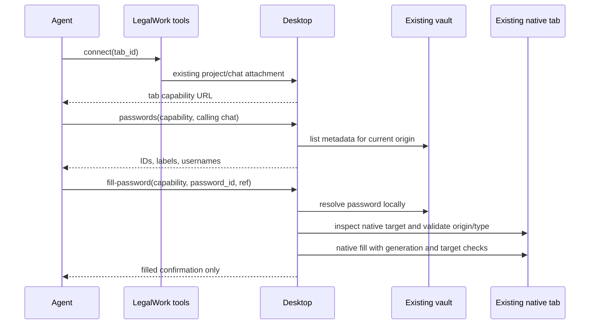

# Browser passwords: first version

LegalWork stores website passwords in its existing encrypted vault and fills them in the agent's existing native v2 browser tab. There is no private login session, new browser partition or cookie transfer. Users can continue using the same tab.

This is a fill-by-reference feature, not a confidentiality boundary against the agent. Unrestricted host commands retain their existing access to the vault and key. Browser evaluation and page scripts can still read a filled field. Network diagnostics and host execution permissions are unchanged. The narrower guarantee is that the password does not enter the fill tool's model-facing arguments or results.

## Storage and settings

`BrowserPasswordStore` uses a namespaced entry in `OAuthVault`, alongside OAuth/connector credentials. The existing vault format, AES-GCM encryption, key source, permissions and module write lock remain unchanged. An outer namespace lock serializes read-modify-write operations without replacing other vault consumers' entries. No browser password becomes an environment variable.

The record contains an opaque UUID, label, exact origin, optional username, password and update timestamp. Management routes require the existing host token:

| Method | Path | Result |
| --- | --- | --- |
| GET | `/browser-passwords` | Metadata only |
| PUT | `/browser-passwords` | Create/update; metadata only |
| DELETE | `/browser-passwords/:id` | Remove saved entry |

There is no API operation to return a password. Settings submits a value only when creating/replacing it. An empty password on edit retains the existing value; changing the origin requires re-entering it. The user may save HTTPS origins; localhost HTTP supports development fixtures. URL paths are discarded, while schemes, hostnames and ports are matched exactly. This first version is local desktop only.

## Agent and desktop flow

`legalwork_browser_passwords` and `legalwork_browser_fill_password` use the existing tab capability broker. Both pass through the existing effective browser network policy. The broker requires the exact owning chat's session header and a live grant. A remote attachment does not receive password actions, and the tools refuse to forward these operations through the manual-server extension gateway.

The desktop resolves the vault value only after admission. It checks the current top-level origin and every native target resource origin, then verifies that the referenced element is an enabled password input. Native generation and target checks reject a document/frame change between inspection and execution. A second current-origin check precedes dispatch. The existing native fill implementation performs the insertion without sending the value through the OpenCode Tool RPC. It does not submit the form, take a screenshot, or return a page observation. Native errors are replaced with a fixed message so a page exception cannot echo the password into the result. Cancellation is propagated and uncertain actions are never replayed automatically.

These checks prevent accidental filling into an unrelated site, frame or stale target. They do not protect against a malicious script on an authorized website or an agent intentionally retrieving the value through unrestricted tools. A stronger isolation design would require a separately agreed scope.

## Validation

Store/route tests cover encryption, metadata-only results, concurrent edits, coexistence with other vault consumers, exact origins, replacement/deletion, host-token route declarations and write gates. Broker/tool tests cover exact chat identity, local-only admission and ID/ref-only requests. Desktop tests cover origin/frame/type rejection, cancellation and error sanitization.

`pnpm --filter @legalwork/desktop test:browser-passwords` uses synthetic credentials and an isolated vault/profile in a hidden Electron window. It exercises the real native controller and capability broker, checks the actual field value, confirms normal snapshots do not echo it, verifies explicit browser readback remains available, and rejects a stale ref after navigation. It makes no model calls and proves the insertion path, not real-model login quality. Compile the server first with `pnpm docs:generate` and `pnpm --filter legalwork-server exec tsc -p tsconfig.json`.
