# Import ChatGPT and Claude plugins

On **Integrations**, choose the single **Import** action in the top toolbar. The chooser offers **ChatGPT**, **Claude**, **GitHub**, and **Folder or ZIP** as separate choices. GitHub opens repository scanning without local file controls. Folder or ZIP opens a compact local import screen without GitHub fields. Both return to the source chooser with Back. ChatGPT and Claude show their logos. **Change app** returns to the chooser. The next dialog shows a searchable list of plugins, skills and standalone MCP connectors found on this computer, using display names and descriptions from package metadata. **All / Plugins / Skills / Connectors** filters sit below the search field and work together with search; returning from a preview keeps both selections. Duplicate versions appear as one row, with other copies available in the source details. You can also choose a complete folder or ZIP with the native file picker. Selecting a source opens a separate review of its skills, connectors, agents, commands and compatibility notices before importing. A folder or archive containing multiple plugin manifests lets you choose the package to import. Import each package individually.

The import popup's **Connectors** filter includes standalone configurations and individual MCP connectors bundled in discovered ChatGPT/Claude plugins. Bundled entries say **From plugin: {name}** and are searchable by the plugin's name. Selecting one previews and imports only that connector, independently of the full plugin. Versions group within their canonical plugin/connector identity; source details retain each copy and its individual connector selection. Remote imports retain just the selected configuration and provenance. Local imports also copy package support files into an independently owned bundle, retaining executable modes and usable package-relative paths; other skills, agents, commands and connectors are not registered. Original manifests and MCP configuration files containing other entries are excluded. Individually imported connectors start disabled, use the normal account/enablement controls, and can be updated or removed without affecting the whole plugin or its other connectors. Discovery uses the same manifest overlays and MCP merge precedence as full imports, reading bounded metadata files rather than loading binary assets or scripts.

Imports are automatically available in all projects, matching the desktop Skills and Connectors libraries. Choose a folder using the native file picker, choose a ZIP, or select an auto-discovered installation. Preview opens automatically after selection. Discovery, installation and removal require owner access and respect custom-plugin, skill and connector policies. The underlying API retains project-scoped installation support for existing integrations.

## Integration libraries

The Integrations page keeps **Plugins / Connectors / Skills / File storage** separate. **Import, Add and More** stay in the same positions with the same button styles on all four tabs. **Add** is the same dropdown everywhere, offering **Plugin, Connector, Skill and File storage**. Selecting an option switches to its library, selects All, and opens its existing creation or connection form. Permissions and firm policies disable unavailable options. Connectors has a separate Browse directory button immediately to the left of Import. The page-level More menu always contains Imported packages and Open skills folder, followed by separated Refresh, on every category. Imported packages opens the existing manager without switching categories; closing it restores focus to More. The folder action stays visible and is disabled when local desktop access is unavailable. One row of normal LegalWork segmented category tabs sits beside search and a compact **Filter** menu. The menu offers All sources, Personal and Team, with a checkmark on the selection. It closes after selection; the button reads Personal or Team when filtering, and Filter when showing all sources. Team items appear alongside personal items with a **Team** label. The second source-tab row is removed, bringing the list directly below navigation.

All library entries use the same icon, name, one-line description and three-dot action menu. Clicking a row opens its details or editor; menus use a fixed order: View details, Edit when available, Export, Share with firm, then separated destructive Remove. Items only offer supported actions, and read-only connectors have no removal action. Enablement, account access and optional team membership live in details rather than adding different controls to different rows.

Healthy empty connector configurations are quiet: they do not show the old “No MCP servers configured” banner or instructions to create `opencode.json`. The combined library owns the empty state and includes firm-managed connectors. Unused configuration-file panels, project/global file controls, duplicate headers, sync labels and their read/state wiring are removed. Connector setup, sign-in, sharing and directory messages use connector terminology; real connection, registration and permission errors remain visible.

Importing one standalone connector switches to Connectors and opens its details once the installed entry is available, clearing any library search that would hide it. The installed result supplies the connector identity. The review explains the next setup step. Whole plugins stay in Plugins even when their only component is a connector. Compatibility notes are reserved for information that affects the import decision: functionality that will not carry over, different execution or permission behavior, model changes, source-only packages, and replacement of an existing package. Routine activation, credentials, working-directory, URL, callback and timeout setup does not produce a compatibility note. Unsupported credential scripts and provider-only authentication still do, because those mechanisms will not carry over. Choosing Sign in on a disabled OAuth connector enables that connector first, then starts the normal sign-in flow. Activation failures do not open sign-in, workspace changes cancel the handoff, and engine reload is deferred until sign-in ends. Local or unauthenticated connectors retain their enablement control.

### Imported connector availability

Connector configuration now appears as soon as the server's list returns, independently of a slower engine status check. Each refresh is tied to the current selected workspace and a request generation; stale responses and disposed stores cannot overwrite a newer list. The import, GitHub plugin install and plugin-creation paths await a configuration-only connector refresh before reporting completion. Engine status continues to refresh through the existing flows.

Previously, an older refresh could replace a newly imported connector with an empty list, producing a false "This item is no longer available" in plugin details. A whole plugin containing just one connector was also mistaken for a standalone connector import. The import review and post-import navigation now share a format-based decision: a whole Claude/Codex/portable plugin remains a plugin, with its component count; a standalone connector retains direct setup.

Verification: two store regressions failed before the fix. The final suite passed **984 app tests across 147 files**, **40 server tests across 4 files**, app TypeScript checks and the production build. Store regressions cover visibility during delayed engine status, configuration-only refresh, stale refresh completion and workspace switching; import presentation checks cover whole one-connector plugins and standalone connector/skill imports. Native Electron re-imported the actual Claude GitHub bundle in the dev profile, verified that the review says Plugin · 1 connector and returns to Plugins, opened its connector immediately, and verified the owned connector row and setup controls in Connectors. The imported connector remains disabled; no provider sign-in was started.

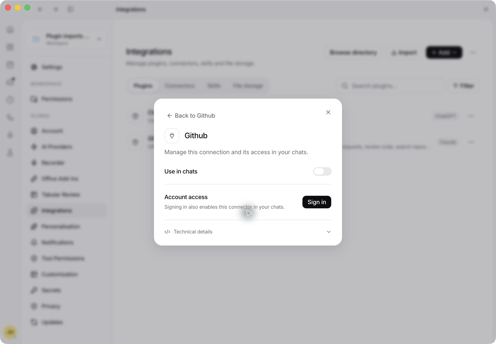

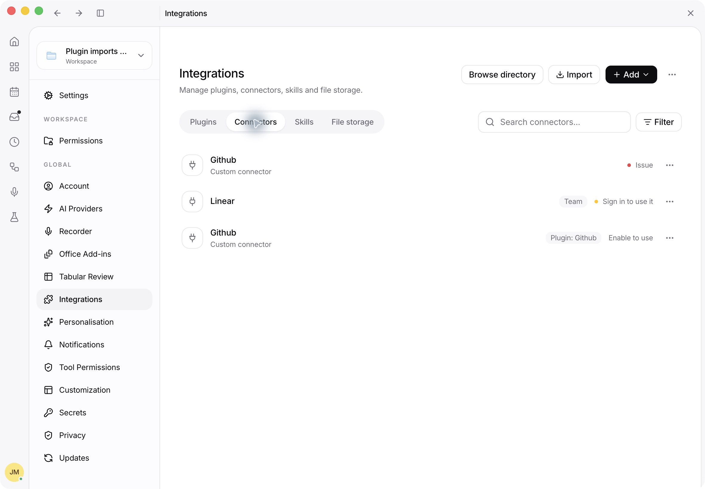

Import reviews adapt to their contents. A single connector, skill, agent or command has one icon, name and type, without a repeated count or contents card. A single component from a plugin retains the package name when it differs; a standalone skill uses its skill name rather than treating its folder as a plugin. Source-only imports have a compact summary without an empty contents list. Larger packages retain grouped component names and counts, without a duplicate total. A lone compatibility note is visible directly; several notes keep their expandable list. Source information stays under Import details, and the package selector appears only for folders with several packages. Reading uses a compact progress view. Discovery uses the top-right cross to close, and review has Back / Import actions.

The first **Plugins** tab manages created and imported workflow bundles with search, source filtering, provider labels, named contents and complete removal. It excludes standalone skill/connector imports. Team explicitly reports that team plugins are not yet available, pending the coordinated work described in the [model-api main audit](plugin-tab-model-api-audit.md). Full bundle imports open Plugins; standalone skills open Skills; a single connector still opens its setup. Engine plugin configuration is a developer-only More action. The all-import manager remains available for standalone import records and their complete uninstall path.

Imported plugin skills and MCP connectors appear once in their respective main libraries, with a **Plugin: {name}** label. Search also matches the owning plugin's name. Ownership comes from recorded installation destinations, so an unrelated item with the same name does not gain a plugin label. New standalone imports retain their source type and are not labelled as plugin components. The package manager remains available under More → Imported packages; package details list the names of its skills, connectors, commands and agents. Import, Refresh and package removal refresh the shared ownership metadata for both libraries.

For manifest-free ZIP bundles containing skills and MCP configuration, the importer removes the complete common enclosing folder path. An extra export folder no longer leaves the connector configuration outside the detected package root.

- **Plugins:** imported bundles use the same rows and menus as the other libraries. Source labels identify ChatGPT/Claude imports. Details show named skills, connectors, agents and commands; removal cleans up the owned package. Read-only clients have no Remove action. Search stays in the shared toolbar, and All/Personal exclude standalone import records. The Team state does not expose the older engine installer.
- **Connectors:** saved connections and active built-in tools appear first; ready items precede paused/offline items. Paused connectors remain available to inspect and enable in details. Browse directory sits immediately to the left of Import and opens the separate searchable catalog with All / Services / LegalWork tools filters. Closing a detail returns to the same directory search. Saved connectors open a compact management modal with chat access, account actions and optional technical details. Team connectors use the same list, ordering and search without duplicate engine-config rows. Optional team membership keeps its review and enablement switch in details; automatic team connectors remain managed by the firm. Team sign-in and member-key controls stay available. Own connectors, removal, sharing, policy restrictions and read-only global configuration retain their behavior.
- **Skills:** personal and team skills use the same rows and menu pattern, with editing, exporting, sharing and removal where supported. All sources also includes built-in expertise with an Included label; Team shows the full Knowledge Hub catalogue, including optional skills not yet added. The main skills library has no extra personal or built-in section headings. Add → Skill opens New skill. The page-level More menu provides Imported packages, Open skills folder and Refresh from every category. All import methods live behind the main Import action. Built-in skills open descriptions and chat commands; imported packages open their components and retain removal. Search includes readable imported names, descriptions and built-in commands. Ordinary skills have no eight-item workflow page limit; workflows retain existing controls and pagination. Package loading/failures have explicit states.
- **File storage:** connected accounts use the same rows, with provider and access mode as their description. Clicking an account opens details with its account/membership controls; personal sources also offer editing and disconnecting through the row menu. Add → File storage opens the existing searchable provider picker and configuration flow. Change provider returns to the picker before saving. Empty/search/error states distinguish an empty library from missing matches. Personal and team sources share one list. Team sources carry a Team label and retain membership/account controls without personal edit/remove actions. Existing access controls remain intact.

This organization follows the installed-item management and separate discovery flows documented in [ChatGPT account management](https://help.openai.com/en/articles/20001494-connecting-and-managing-app-accounts-in-chatgpt), [Claude connectors](https://support.claude.com/en/articles/11176164-use-connectors-to-extend-claude-s-capabilities), and [Claude's directory](https://support.claude.com/en/articles/14328846-browse-skills-connectors-and-plugins-in-one-directory), reviewed October 11, 2026. LegalWork keeps its existing design-system tokens and the four-category library navigation.

**Browse directory** is a global toolbar action, immediately to the left of Import on Plugins, Connectors, Skills and File storage. It opens the existing shared app/connector directory from every category. Closing it preserves the selected category and its library search; the inactive connector library does not render its search into another category's toolbar. Read-only clients can browse, and busy states disable the action. The existing directory setup, account and policy flows are reused.

Global-directory verification: app TypeScript checks and **35 focused tests across 3 files** passed. Native Electron verified opening/closing from all four categories, returning to each selected category and preserving a Plugins search. No account, connector or plugin was changed.

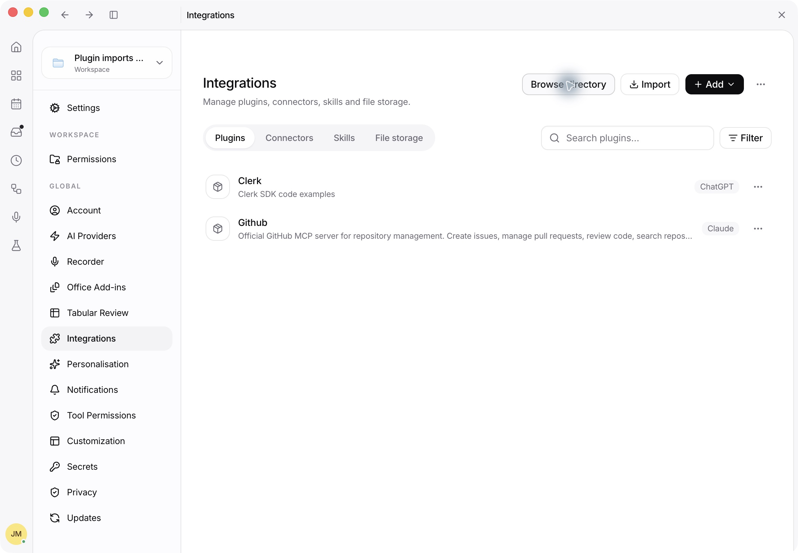

## Connector status consistency

Personal, plugin and team connectors now use one state resolver and presenter for labels and indicators. Sign-in uses **Sign in to use it** with an amber dot; disabled entries use **Enable to use** without a dot; missing personal keys use **Add your key to use it** with an amber dot; incomplete sign-in setup uses **Sign-in setup is incomplete** with an amber dot; failed connections use **Issue** with a red dot; disconnected entries use **Offline** with a gray dot. Connected entries have no redundant Ready label. Directory sign-in prompts, connector details and team error titles use the same wording. Optional membership and missing keys take precedence, while actual failures and setup errors are preserved instead of becoming generic sign-in prompts.

The mismatch came from separate presentation logic in `mcp-view.tsx` and `firm-connectors.tsx`, including different translation keys and missing team indicators. Both receive the same runtime status map. Team metadata supplies firm ownership, membership and personal-account requirements; keeping those permissions separate is necessary. The screen's remaining structural debt is the large connector component mixing directory browsing, library orchestration and detail controls. Further cleanup should split those responsibilities and adapt source metadata to shared presentation, while retaining the existing server, account and ownership APIs.

Verification: four new rendered-library regressions failed before the fix. The final suite passed **978 app tests across 147 files**, app TypeScript checks and **5,785 translation keys × English/German**. The state matrix covers personal/plugin/team sign-in, setup, failure, disabled, connected and disconnected rows, including matching indicator colors. Existing tests cover optional membership, key requirements, account actions and read-only controls. Native Electron verified the actual GitLab plugin and Linear team rows with identical sign-in text and indicators. No connector or provider account was changed.

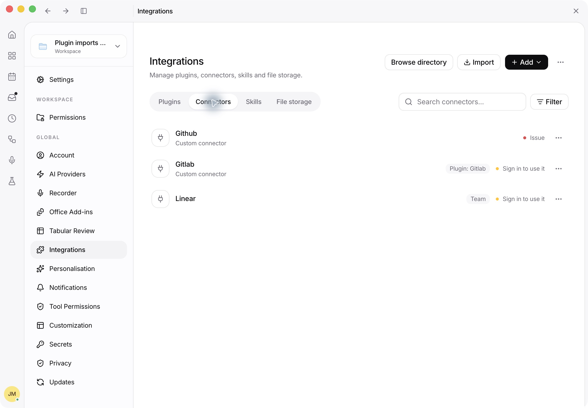

## Plugin details

Plugin details now have a fixed header, a bounded scroll area and readable component names instead of execution identifiers. Larger bundles have an in-plugin search that matches component names and skill descriptions; small bundles keep the compact layout without a search field. Skills, connectors, commands and agents appear in consistent clickable rows, grouped only by the types actually present.

Opening a skill shows its rendered instructions and attached-file controls, with Edit/Save when permitted. The library and plugin share the same skill dialog, including loading/errors and protection against leaving unsaved changes. Connectors open the existing activation, account/sign-in and technical-detail controls. Agents and commands open a read-only instruction view with loading, retry and missing-item states. Each component has **Back to {plugin}**; returning preserves the plugin search and scroll position. The top-right cross closes dialogs, without redundant footer Close buttons.

Personal and imported skills opened from the Skills tab start in the same rendered instruction view as plugin skills. Choose **Edit** to change their instructions. Workflows retain their existing edit-first behavior.

Skills-tab verification: app TypeScript checks and **40 focused tests across 5 files** passed. Native Electron verified opening Clerk Android from Skills, rendered instructions, Edit opening the editor, and closing/reopening without changing the installed file.

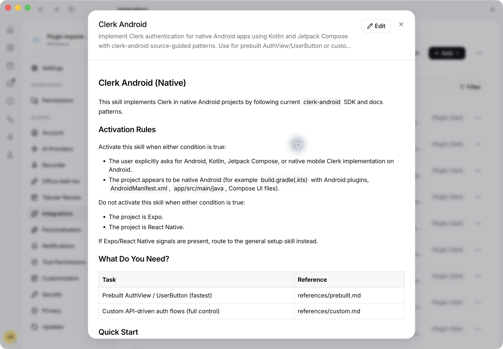

Display names are separated from installed identities. Component opening uses recorded installation destinations and full connector keys, so readable labels cannot accidentally select a similarly named skill or connector from another plugin. The document API reads only registered agent/command files, requires host access for global packages, rejects linked/unowned paths and bounds displayed files to 1 MB. Read-only servers retain reading access.

Verification: **972 app tests across 147 files**, **35 server tests across 3 files**, app/server TypeScript checks, the production build, runtime bundles and **5,785 English/German translation keys** passed. Native Electron verified the actual Clerk bundle's readable 21-skill list, opening Clerk Android and returning to Clerk. An isolated browser fixture with production components verified search, skill view/edit/save, unsaved-change cancellation, returning to the same filtered list, bundled connector activation/sign-in controls, agents, commands and failed-document retry. Editing in that fixture used an in-memory store; the actual installed Clerk files and provider accounts were not modified. The temporary fixture was removed.

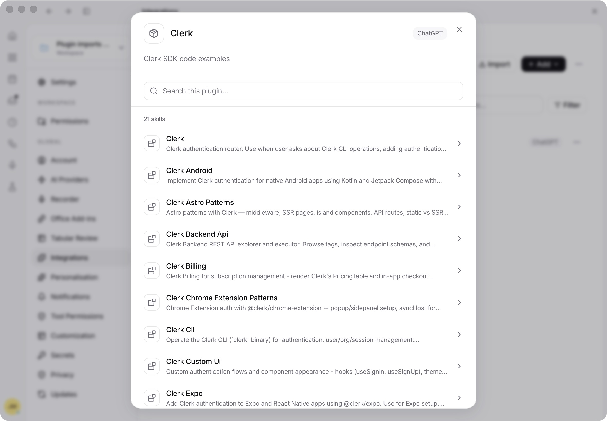

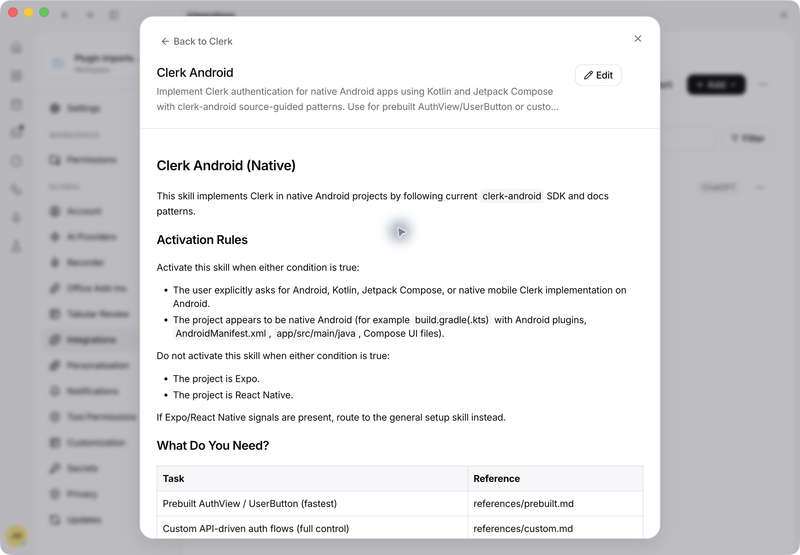

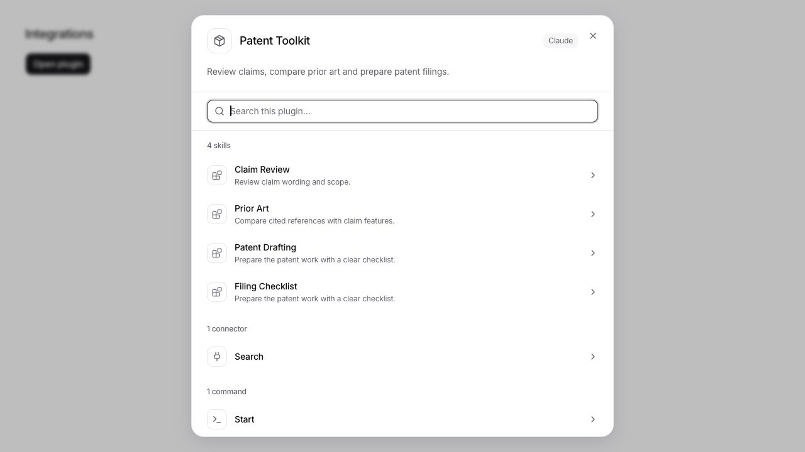

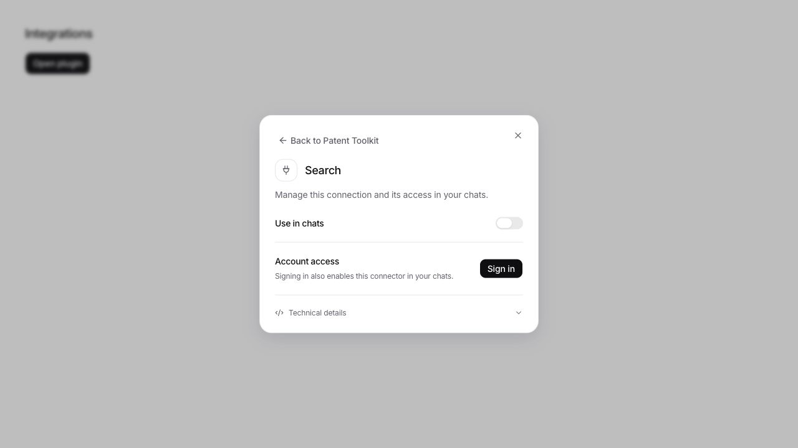

## Creating a plugin

Choose **Add → Plugin** on any Integrations category. The standard creation dialog asks for a name, an optional description, and skills/connectors from the personal library. Search filters the choices while preserving selections. Creation requires at least one item; empty/loading/error and saving states remain in the same dialog. Successful creation opens Plugins with the new bundle. Cancel discards the form and returns focus to Add.

The host-only workflow-plugin API creates a global, independently owned bundle with a native LegalWork identity, rather than labelling it as a ChatGPT/Claude import. It copies complete skill folders and executable resources. When an item belongs to an imported package, its supporting source bundle is copied and resource paths are rebased so removing the original package does not break the new copy. Selected connector configurations are copied disabled; saved OAuth sign-ins are never read or moved. Removal uses the existing package lifecycle and preserves the original skills/connectors. Empty/duplicate selections, missing items, linked resources, excessive package size and duplicate plugin names are rejected. Host authorization, read-only mode, firm policies, approval, audit, rollback and workspace reloads use the existing server surfaces. Firm-managed items and built-in app tools are not creation options.

Creation verification: server tests passed **34 tests across 3 files** (`pnpm --filter legalwork-server exec bun test src/plugin-imports.test.ts src/connector-imports.test.ts src/cloud-plugins.test.ts`), including real API creation, owner enforcement, concurrent duplicate-name rejection, cross-project visibility, read-only rejection, full resource copies and removal preserving originals. App tests passed **971 tests across 147 files**, including the focused **33-test** library/import suite. App/server TypeScript compilation, the production app build, server runtime bundles and English/German translations (**5,777 keys**) passed. Native Electron verified Add → Plugin, readable component names, search, mixed skill/connector selection, disabled submission without contents, and cancellation/focus return. No real account was connected or user plugin created during desktop verification.

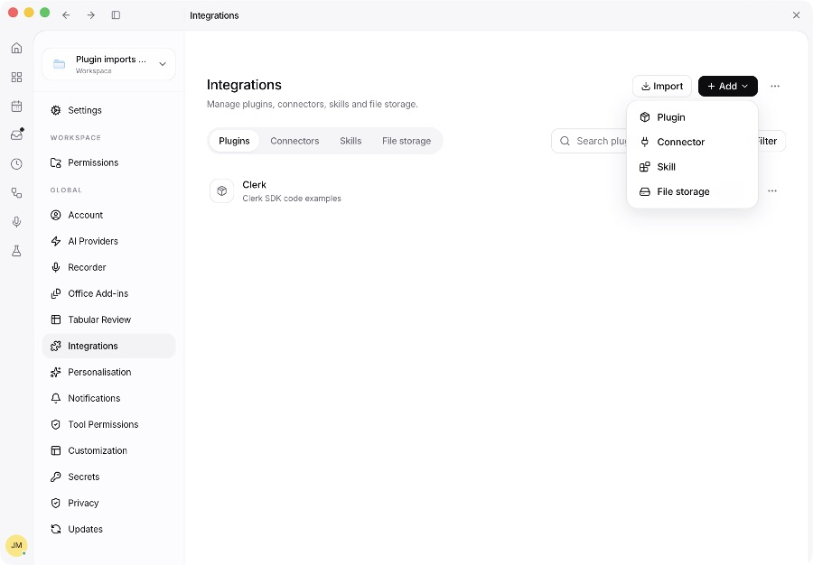

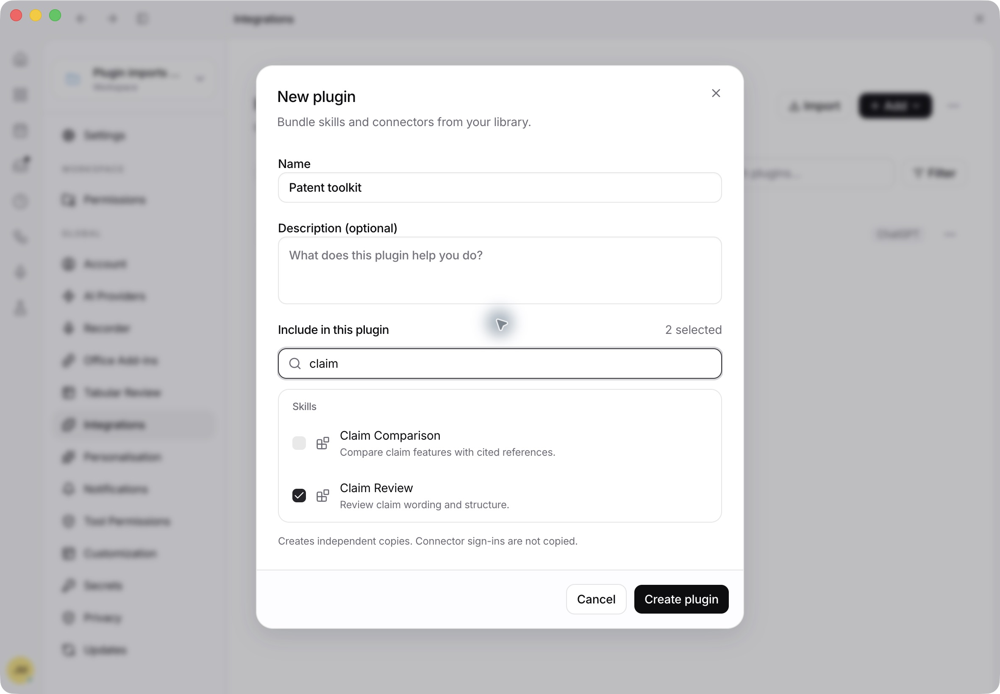

## Supported formats

- ChatGPT/Codex compatibility packages: `.codex-plugin/plugin.json`, plugin-relative `skills` paths, `.mcp.json` (or manifest-declared MCP files/configuration), and `.app.json` metadata.
- OpenAI portable packages: root `plugin.json` and `mcp.json`, `skills/`, `extensions.com.openai`. Portable identity stays canonical. An inline OpenAI extension replaces the legacy `.codex-plugin/plugin.json` overlay.
- Claude packages: `.claude-plugin/plugin.json`, or manifest-free standard folders. Default and additional skill directories; command/agent files and directories; inline command definitions. Default `.mcp.json` merges before manifest-declared MCP files, inline maps and arrays, with later server definitions overriding earlier ones.
- Standalone MCP connectors: Codex `config.toml` (`mcp_servers`), Claude Code `.claude.json` (user and local-project `mcpServers`) and project `.mcp.json`, and Claude Desktop `claude_desktop_config.json`. Discovery also checks MCP config files in projects recorded by Claude/Codex. Each connector is selectable independently, even when names overlap.
- Standalone `SKILL.md` folders and skill collections, including archives with an extra enclosing folder.

Skills, agents, commands and MCP servers are registered with names scoped to the source provider/package and installation scope; project connector names also include the target project. The original source folder is retained under `.opencode/imported-plugins/<package-namespace>/` (or the global OpenCode configuration directory). Binary files, shared scripts, reference material, manifests and other assets are preserved; skill resources are also projected next to their active `SKILL.md`. Source files are never rewritten. Generated `.git` and `node_modules` directories and OS metadata are excluded. Install script dependencies separately when needed.

Active instructions retain skill metadata, translate agent/command metadata for OpenCode, resolve `CLAUDE_PLUGIN_ROOT`, `CODEX_PLUGIN_ROOT`, portable `PLUGIN_ROOT`, `CLAUDE_SKILL_DIR` and `CLAUDE_PROJECT_DIR`, and include a mapping of imported component names. Local MCP executable paths and packaged relative script arguments resolve to the preserved bundle. Source executable bits are retained for folder imports and Unix ZIPs. The bundle includes a `LEGALWORK-IMPORT*.json` compatibility report.

Standalone connector imports retain only the selected MCP entry and a source record, never the whole application configuration. Codex environment allowlists, HTTP headers, environment-backed headers/bearer authentication and OAuth client IDs are translated. Environment secrets and stored account/OAuth sessions are not read. Connectors import paused with a visible explanation; successful import opens Connectors for review and activation. Unsupported tool restrictions, approval rules and ChatGPT-only authentication are explicitly reported. Callback and timeout setup is not a compatibility warning; the source record retains those settings. Reimport replaces the same source entry; uninstall removes its registered connector. Connector cards show readable names while execution identifiers remain unique.

## Features requiring adaptation

Importing the complete source does not reproduce another platform's runtime. The preview explicitly reports these differences:

- ChatGPT registered app IDs and provider-managed authorizations require reconnecting in LegalWork. Account tokens are not read or transferred.
- OAuth client IDs and scopes can be mapped. Endpoint overrides, confidential-client registration and API-key setup require configuring the connector in LegalWork.
- Unresolved environment/user-configuration variables, working-directory requirements and authentication helpers import the connector disabled. A templated/empty remote URL gets a disabled placeholder endpoint; the original configuration remains in the bundle. No environment credentials are read during import. Environment-default syntax uses its declared fallback.
- Claude/OpenAI hooks, LSP configuration, settings, output styles, experimental components, platform workflows and package dependencies are retained but are not automatically activated.
- Model aliases such as `sonnet` and `opus`, platform-specific permission/invocation metadata, dynamic context injection and session/data-directory variables require reviewing/adapting in LegalWork. Fully qualified OpenCode models are retained; foreign permission metadata does not grant permissions.
- An onboarding skill is available as a normal imported skill; setup does not run automatically.

Discovery checks the documented personal/project skill locations, plugin caches, `CODEX_HOME`/`CLAUDE_CONFIG_DIR`, Claude's `installed_plugins.json`, and OpenAI local/repository marketplace source paths. Cloud-only packages must first be exported or downloaded. The importer does not crawl accounts or arbitrary home folders.

The desktop supplies the actual OS home directory for discovery, including in development when the runtime library lives in an isolated home directory. Discovery reads existing installations; importing still writes to the active LegalWork library.

## Updates and limits

Reimporting the same provider/package name replaces the installed package in the selected scope; the preview announces this. Complete package directories are replaced so deleted resources and connectors are pruned. On installation failure, the previous package directories, import record and package-owned connectors are restored. Uninstall removes the retained bundle, active components and registered MCP entries. Removal dialogs state that packages affect all projects. Display names are retained in the installed library, and imported skill cards show readable component names; canonical package and execution identifiers remain unchanged for updates and removal. A successful import opens Skills and confirms the imported package.

Installation requires the digest from the reviewed preview. Source, scope or target changes require another preview. Package names are hashed into namespaces to avoid overwriting other packages. Existing unowned destination files cause a conflict. Folder/ZIP inputs reject traversal, linked files/directories, duplicate archive paths (including case collisions), encrypted/multi-volume/ZIP64 archives and excessive sizes. Limits: 64 MB of source/expanded ZIP data, 5,000 source files, 128 MB/10,000 installed resource files, folder nesting up to 24 levels.

## Format references (reviewed October 2026)

- [OpenAI plugin build guide](https://developers.openai.com/plugins/build/plugins): compatibility/portable manifests, root-relative paths, local marketplaces, MCP authentication and onboarding.
- [OpenAI skills guide](https://developers.openai.com/plugins/build/skills): skills and supporting resources.
- [Agent Plugins manifest schema](https://agent-plugins.org/schemas/1.0.0/plugin.schema.json) and [MCP schema](https://agent-plugins.org/schemas/1.0.0/mcp.schema.json).
- [Claude plugin manifest reference](https://code.claude.com/docs/en/plugins-reference): optional manifests, component paths, inline definitions, merge precedence and local installation layout.
- [Claude skills reference](https://code.claude.com/docs/en/skills): standard/extended frontmatter, resource directories and runtime substitutions.
- [OpenAI MCP configuration](https://developers.openai.com/codex/mcp): TOML connector fields and environment/authentication settings.
- [MCP local-server setup](https://modelcontextprotocol.io/docs/develop/connect-local-servers): Claude Desktop config locations and format.
- [Claude MCP reference](https://code.claude.com/docs/en/mcp): configuration formats, environment expansion, OAuth and helper differences.

## Validation

Native Electron verification found existing installations for both providers, filtered discovery by name and type, checked combined search/filter empty results and Back behavior, imported a Claude folder and a ChatGPT ZIP through the native pickers, and verified the resulting package cards and readable skill names. The ZIP fixture contained skills, a connector, an agent, a command and supporting files; its missing-credentials connector remained disabled. Routine credential setup is no longer a compatibility note. Standalone Claude and Codex MCP connectors were also discovered from project configuration, reviewed and imported into the paused connector library. A Node runtime smoke check verifies TOML discovery and header translation independently of the Bun test runner. No real MCP service was connected.

`pnpm --filter legalwork-server exec bun test src/connector-imports.test.ts src/plugin-imports.test.ts src/cloud-plugins.test.ts src/claude-plugin-bundle.e2e.test.ts src/runtime-opencode-config-store.test.ts src/validators.test.ts` exercises both providers, wrapped ZIP/folder imports, source assets and executable files, names/metadata, MCP precedence and exact arguments/environment/header values, global/project scope, cross-project removal, updates, rollback, source digests, ownership and malformed/oversized inputs.

`pnpm --filter @legalwork/app test`, app/server `typecheck`, app `test:i18n`, and app/server builds cover the UI and integration. Native Windows folder selection and real third-party MCP OAuth flows require platform/credential testing separately.

## Library redesign verification

The four libraries share one category-navigation row, with search and the compact source Filter menu alongside it. Personal and team items appear in one list, with Team labels on shared entries; built-in skills carry Included labels. Selecting All sources restores the combined list. The source persists across category changes, and search persists across source changes. Successful imports and Add selections reset the source to All so personal items are visible. Source filtering does not grant editing rights over firm-managed items.

Import, Add and More use the same styles and positions. Add offers Connector, Skill and File storage on every category and opens the selected library's existing form. Connectors also has Browse directory immediately left of Import. The page-level More menu provides Imported packages, Open skills folder and Refresh from every category. All import methods remain behind the single main Import action, with separate ChatGPT, Claude, GitHub and Folder or ZIP choices. Workflows retain their existing controls and pagination.

Rows use the same icon, name, description and action menu. View details comes first, followed by supported Edit, Export and Share actions, then separated Remove. Sharing reviews only the selected item. Optional team membership retains its confirmation, installed team skills retain their read-only resource viewer, and automatic items remain firm-managed. Connector account/enablement controls and storage membership stay in details. Unavailable expand arrows, Ready/Paused labels, the sync indicator and the global project-availability badge are removed. Team empty states consistently say no items have been shared by your firm yet, without extra explanatory paragraphs.

Personal, team and built-in skills use the same row spacing across their list boundaries. The old section margin is removed in the embedded library, and an empty team catalogue contributes no blank space. Native Electron verified the personal-to-built-in boundary; the focused 20-test suite and app type checking passed again.

Latest checks:

- Public Plugins tab: the full app suite passed **971 tests across 147 files**, and the focused import/library suite passed **33 tests across 4 files**. App type checking, translations (**5,760 keys × English/German**) and the production build passed with the existing chunk-size warning. Native Electron opened the actual Plugins route and its empty state. A temporary browser fixture using the production Integrations, package and import views verified populated bundles, standalone-record exclusion, provider labels, contents, global import-manager access, source filtering, complete-bundle import returning to Plugins from Team Skills, search, confirmed removal without restoring stale cached rows, read-only controls and developer-only engine management. All mutations used sample stores; no real bundle, connector or account was changed. The fixtures and browser tabs were removed.

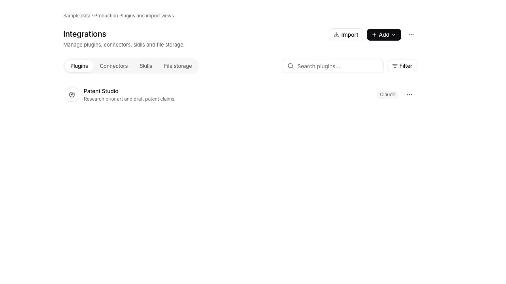

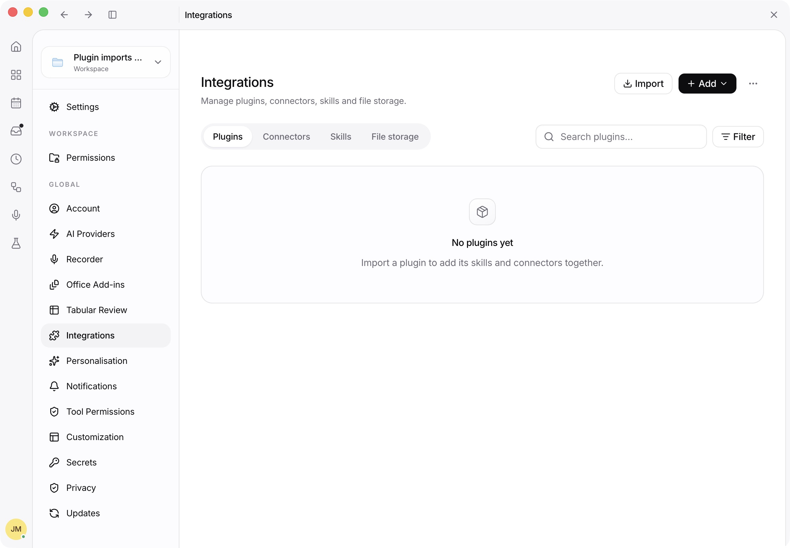

- Compact import reviews: the focused app import/library suite passed **31 tests across 4 files**, and app type checking, translations (**5,755 keys × English/German**) and the production build passed with the existing chunk-size warning. A temporary browser fixture rendered the actual production popup with sample stores and verified both provider layouts, single connectors and skills, a one-skill plugin with a distinct package name, mixed component packages, source-only imports, multiple-package selection, source details, one/multiple compatibility notes, reading dismissal, import failure, retry and disabled progress controls. The fixture and browser tab were removed. No real connector, package or account was changed. The running Electron dev app receives the updated UI.

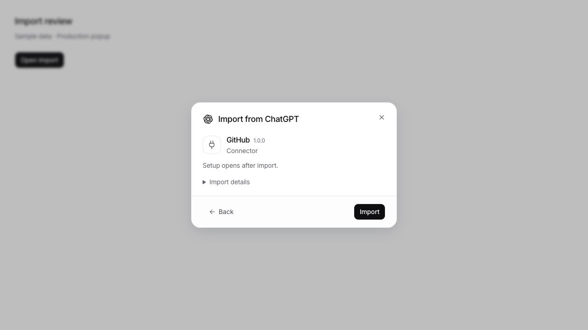

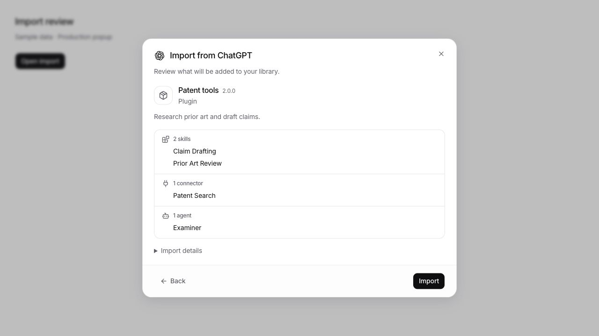

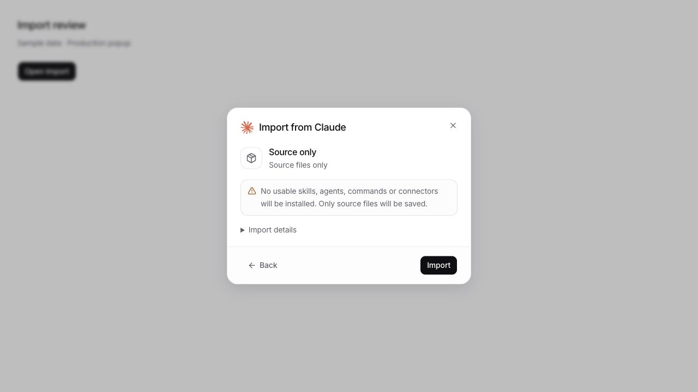

- Compatibility-note audit: the focused server import/install suite passed **38 tests across 5 files**, with regressions for ordinary GitHub/environment/OAuth setup producing no note, retained unsupported execution/permission/authentication behavior, and source-only packages. App/server type checking and the runtime build passed. Native Electron previewed the actual bundled GitHub connector and verified that the generic credential/environment note is absent. No connector was imported or account connected during this check.

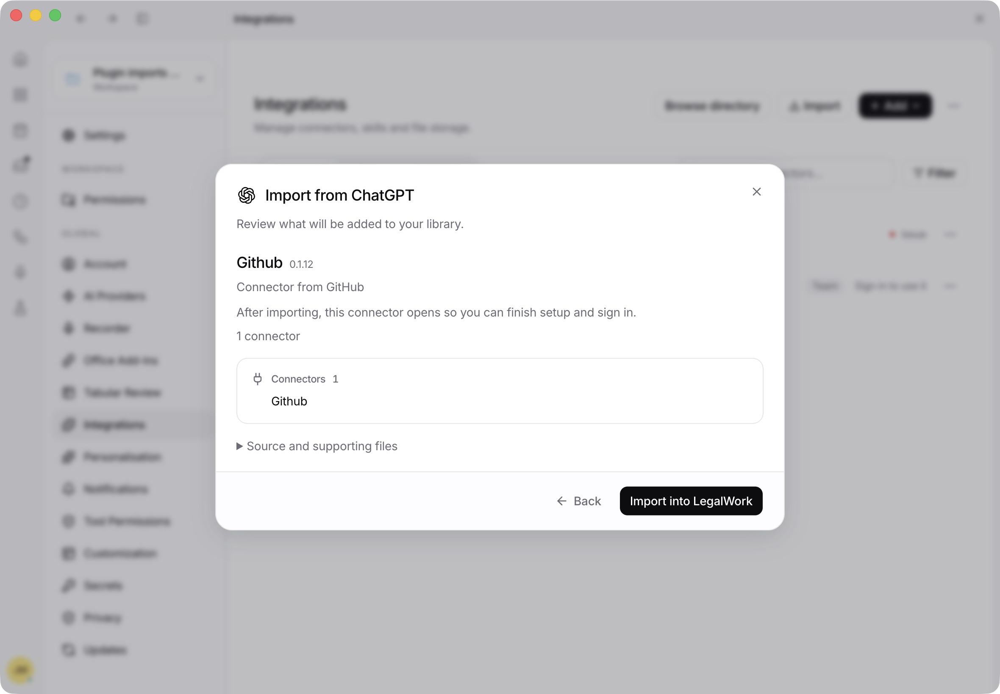

- Single connector setup: the full app suite passed **969 tests across 147 files**, the focused import/account/library suite passed **49 tests**, and the server import/install suite passed **34 tests**. App/server type checking, translations (**5,755 keys × English/German**) and the production app/runtime builds passed with the existing app chunk-size warning. A temporary browser fixture using the production Integrations/import/connector components verified a clean review, import-result identity, delayed list refresh, search clearing, automatic details opening and the Sign in control. Store regressions cover enabling before sign-in, rejected activation and switching workspaces during activation. The fixture was removed; no real provider account was connected. The Electron dev app was restarted with the updated importer.

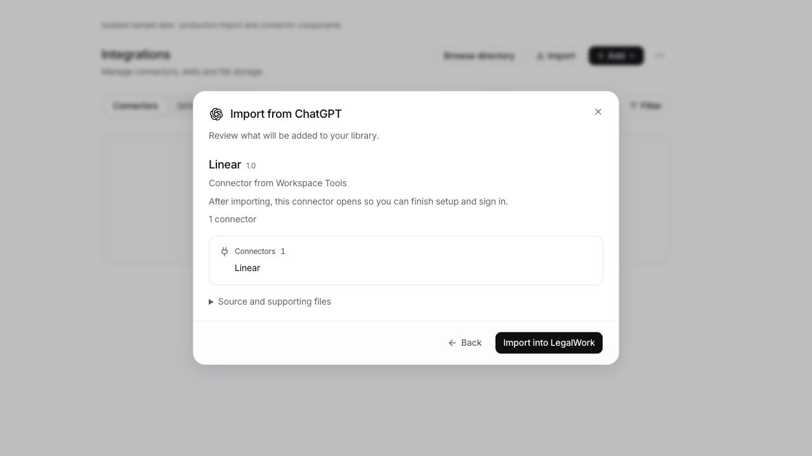

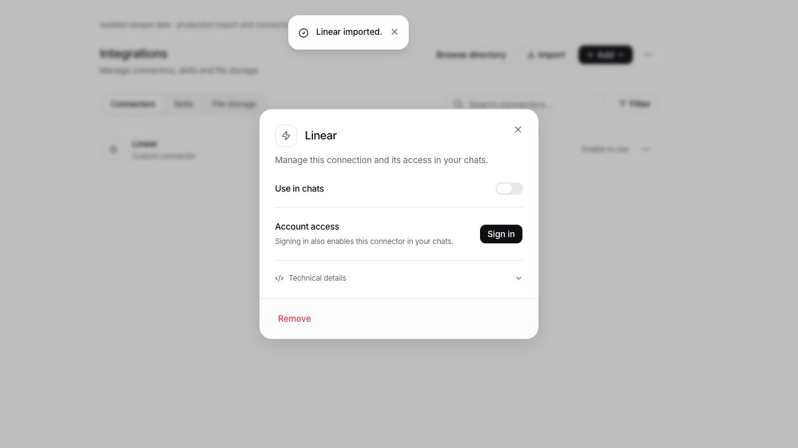

- Legacy connector UI cleanup: `pnpm --filter @legalwork/app test` passed **966 tests across 147 files**. The focused connector/store/account suite passed **57 tests**, including healthy empty server/file configurations, team-only rows and retained registration errors. App type checking, translations (**5,754 keys × English/German**) and the production build passed with the existing chunk-size warning. Native Electron verified the actual Linear team row without the legacy banner, the directory's connector wording and returning to the list. No connector, account or membership was changed.

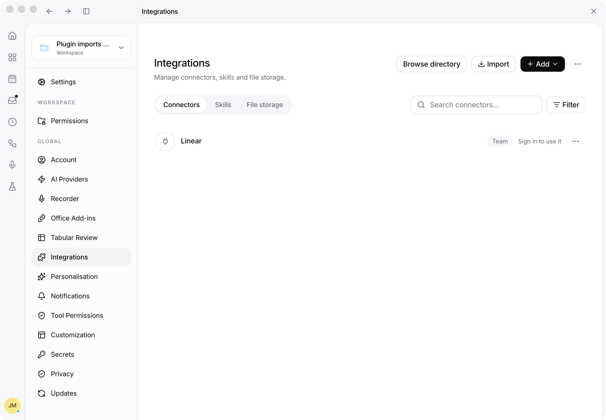

- Bundled connector selection: the focused server import/install suite passed **34 tests across 5 files**, including both provider formats, MCP precedence, configuration isolation, executable support files, independent update/removal and selector/link validation. The focused app library/presentation suite passed **30 tests**. App/server type checking, the production app build (existing chunk-size warning), translations (**5,772 keys × English/German**), and the full app suite (**962 tests across 147 files**) passed. A browser fixture using the production import popup and metadata/previews generated by the real server importer verified standalone plus bundled connector rows for both providers, parent-plugin search, connector-only review, retained Back filtering, alternate-version selection, and a digest-checked import callback. The temporary fixture was removed; no real account or connector was changed.

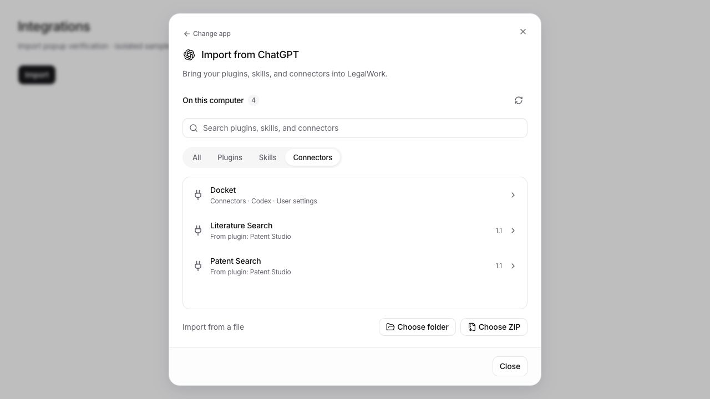

- Plugin-component visibility: `pnpm --filter @legalwork/app test` passed **961 tests across 147 files**. App/server type checking, app build and translation checks passed (**5,770 keys × English/German**), with the existing app chunk-size warning. `pnpm --filter legalwork-server exec bun test src/connector-imports.test.ts src/plugin-imports.test.ts src/cloud-plugins.test.ts src/claude-plugin-bundle.e2e.test.ts` passed **29 tests**. A browser fixture using the production Integrations/import/package components and in-memory stores verified a ChatGPT plugin import, immediate skill/connector visibility, plugin-name search, named package contents, and removal preserving personal/built-in items. The fixture was removed; no real connector or account was changed.

- `pnpm --filter @legalwork/app exec bun test tests/plugin-import-buttons.test.tsx tests/integration-libraries.test.tsx tests/mcp-library.test.tsx` — 20 passed. Coverage includes source isolation, complete team catalogue rendering and deduplication, embedded search, built-in command search and storage ownership restrictions.
- `pnpm --filter @legalwork/app typecheck` — passed.
- `pnpm --filter @legalwork/app test:i18n` — passed, 5,755 keys × English/German.
- `pnpm --filter @legalwork/app build` — passed, with the existing large-chunk warning.
- The preceding full app suite passed 949 tests across 146 files during the earlier library/import verification.

Native Electron verified All sources, Personal and Team selection, active source labels, menu dismissal after selection, keyboard selection, retained connector search across source changes, source persistence across categories, Skills excluding built-ins under Personal, and the inline Team skills empty state. Actual shared storage sources appear under All/Team with Team labels and are excluded by Personal. Add → Skill from Team File storage opened New skill and reset the source to All. Forms were cancelled; no connection, team membership, credential or shared item was changed. This account has no team skills, so populated catalogue rendering is covered by cached server-view fixtures.

Earlier native checks covered both providers' discovery, folder/ZIP pickers, component review, Back/close/focus, complete Claude-folder/ChatGPT-ZIP imports, paused standalone MCP imports, directory search/filter/detail return, connector setup/account details, package components, selected-item sharing and storage configuration. Windows pickers and real third-party OAuth require separate platform/credential checks. The desktop dev server remains running for review.

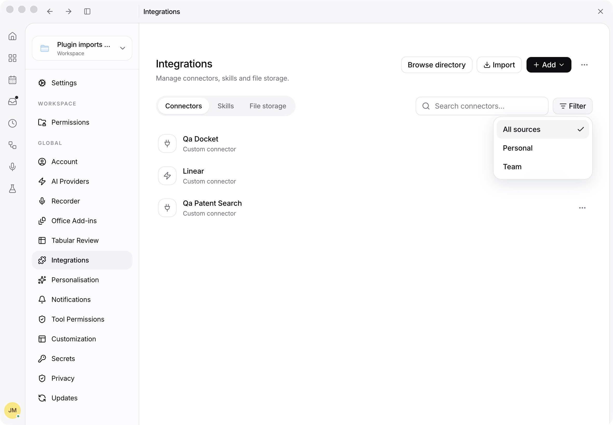

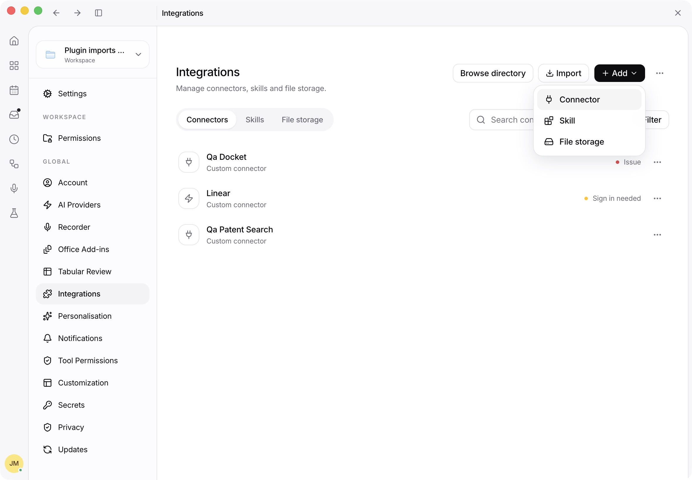

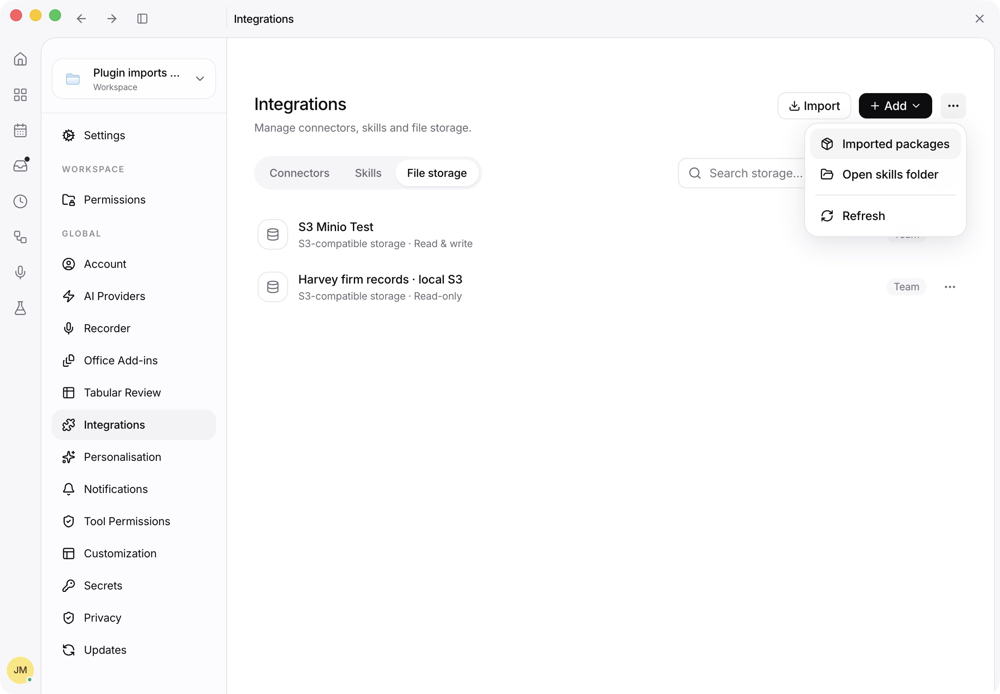

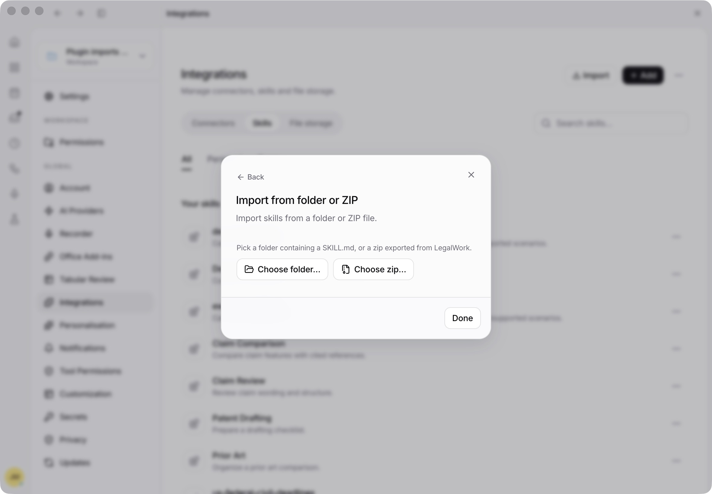

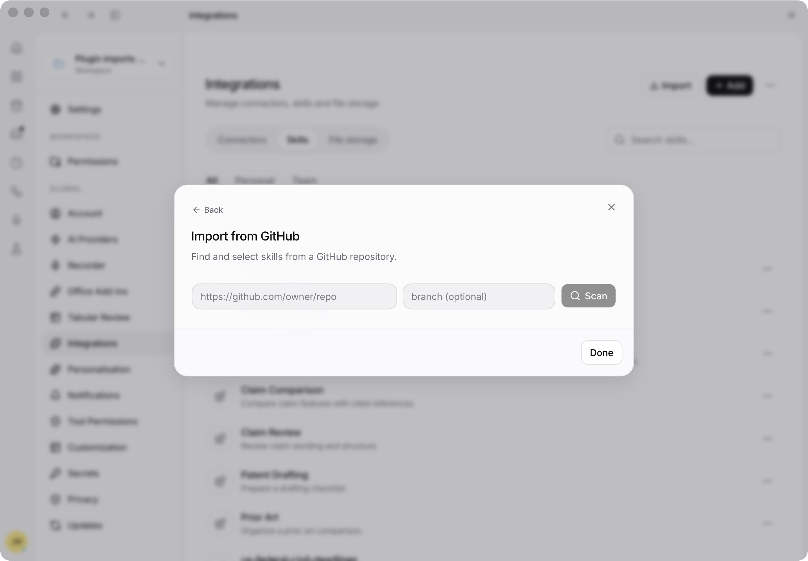

The common-tools menu passed app type checking, the focused 20-test suite and the production build. Native Electron verified the same menu entries on Connectors, Skills and File storage, opening Imported packages from Connectors and File storage without changing categories, and returning focus to More on close. Open skills folder from File storage revealed the existing skills directory in Finder. No package, account or membership was changed.

Connector setup reuses the same **HubTabs** segmented switcher as Integrations and Recorder for **URL / Local server**, above the shared name field. Its shape, spacing, selected surface and focus treatment come from that shared component. URL shows the server address and request-header controls with Continue; Local server shows the command field with Add. Remote workers retain URL-only setup. Native Electron verified switching in both directions with mouse and keyboard, without submitting the form or running a command. App type checking and the production build passed; `pnpm --filter @legalwork/app exec bun test tests/add-mcp-modal.test.tsx tests/mcp-custom-connector.test.ts tests/integration-libraries.test.tsx` passed all 29 tests, and `pnpm --filter @legalwork/app test:i18n` passed with 5,757 keys in English/German.

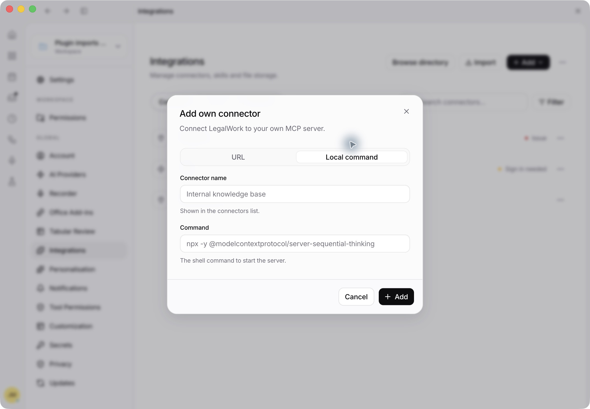

Personal connector details retain only Remove in the footer; the top-right cross closes the dialog. Read-only connectors have no footer. Share with firm is available through the library row menu. Native Electron verified the simplified footer without changing connector access or signing in. `pnpm --filter @legalwork/app typecheck` passed, and `pnpm --filter @legalwork/app exec bun test tests/mcp-library.test.tsx` passed all 8 tests.

Installed team connectors that require their own account now show **Sign in to use it** before the engine reports a status. **Sign in** is also available in the existing row menu and details dialog, using the same account flow. Connected accounts show no sign-in prompt; connection failures and member-key requirements retain their own messages, and optional connectors must still be added before sign-in. The regression reproduced the missing label with no engine status and with a disconnected status before the fix. Native Electron verified the actual automatically installed Linear row, menu and details without starting sign-in or changing account access. `pnpm --filter @legalwork/app exec bun test tests/mcp-library.test.tsx` passed 10 tests; `pnpm --filter @legalwork/app test` passed 951 tests across 146 files. App type checking and the production build passed, with the existing build chunk-size warning.

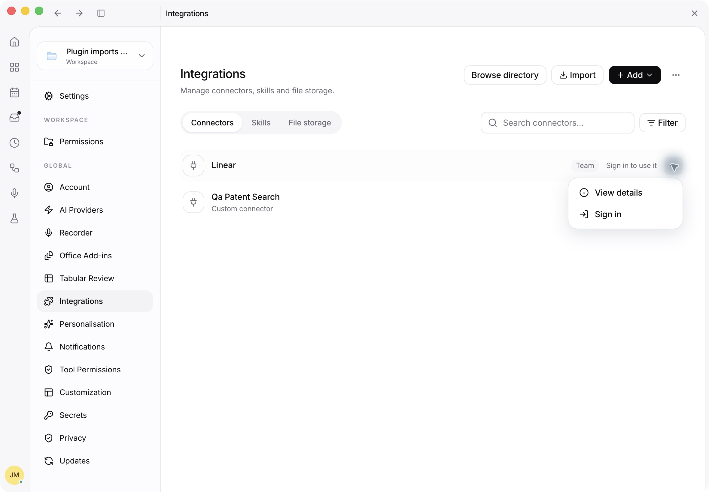

Team connector details now use the existing icon/header, access rows, buttons and alert components. Automatic connectors show **Managed by your firm** in the header and no enablement row. Optional connectors show an **Enable connector** switch with the explanation that it allows agents to use the connector. Account access has one applicable sign-in or personal-key action, while connected accounts, firm-provided access and open access explain their state without prompting for credentials. Missing sign-in addresses and registration/connection failures have clear explanations; pending actions are disabled with progress indicators. The top-right cross closes the popup; team connectors have no footer. Existing optional-membership review and key/sign-in flows remain intact.

Native Electron verified the actual Linear popup, with no misleading Use in chats row. A local browser fixture using the production row and dialog checked 12 states: sign-in required, signed in, optional unadded/added, personal key missing/saved, firm/open access, missing sign-in address, connection failure, registration required and pending changes. No account or membership action was submitted. `pnpm --filter @legalwork/app exec bun test tests/firm-connector-details.test.tsx tests/mcp-library.test.tsx` passed 17 tests. App type checking, production build and translations passed, with 5,768 keys in English/German and the existing build chunk-size warning.

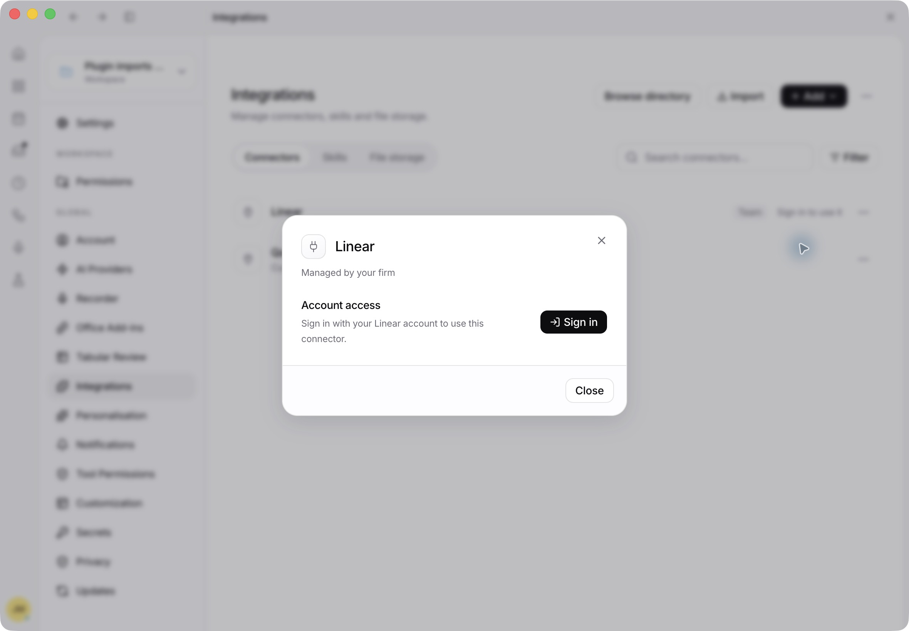

Footer Close buttons are removed from personal and team connector details. Native Electron verified both dialogs and closing them with the top-right cross. `pnpm --filter @legalwork/app typecheck` and `pnpm --filter @legalwork/app exec bun test tests/firm-connector-details.test.tsx tests/mcp-library.test.tsx` passed again (17 tests).
