# Import ChatGPT and Claude plugins

On **Integrations**, choose **Import** in the top toolbar, then select **ChatGPT** or **Claude** in the provider chooser. Both choices show their logos. **Change app** returns to the chooser. The next dialog shows a searchable list of plugins, skills and standalone MCP connectors found on this computer, using display names and descriptions from package metadata. **All / Plugins / Skills / Connectors** filters sit below the search field and work together with search; returning from a preview keeps both selections. Duplicate versions appear as one row, with other copies available in the source details. You can also choose a complete folder or ZIP with the native file picker. Selecting a source opens a separate review of its skills, connectors, agents, commands and compatibility notices before importing. A folder or archive containing multiple plugin manifests lets you choose the package to import. Import each package individually.

Imports are automatically available in all projects, matching the desktop Skills and Connectors libraries. Choose a folder using the native file picker, choose a ZIP, or select an auto-discovered installation. Preview opens automatically after selection. Discovery, installation and removal require owner access and respect custom-plugin, skill and connector policies. The underlying API retains project-scoped installation support for existing integrations.

## Integration libraries

The Integrations page keeps **Connectors / Skills / File storage** separate. **Import, Add and More** stay in the same positions with the same button styles on all three tabs. Add opens the creation or connection form directly on every tab. Connectors has a separate Browse directory button immediately to the left of Import. More holds library tools followed by Refresh, with separators between tool groups. The normal LegalWork segmented tabs sit beside search. The Local/Team switch is removed: team items appear alongside personal items with a **Team** label.

All library entries use the same icon, name, one-line description and three-dot action menu. Clicking a row opens its details or editor; menus use a fixed order: View details, Edit when available, Export, Share with firm, then separated destructive Remove. Items only offer supported actions, and read-only connectors have no removal action. Enablement, account access and optional team membership live in details rather than adding different controls to different rows.

- **Connectors:** saved connections and active built-in tools appear first; ready items precede paused/offline items. Paused connectors remain available to inspect and enable in details. Browse directory sits immediately to the left of Import and opens the separate searchable catalog with All / Services / LegalWork tools filters. Closing a detail returns to the same directory search. Saved connectors open a compact management modal with chat access, account actions and optional technical details. Team connectors use the same list, ordering and search without duplicate engine-config rows. Optional team membership keeps its review and enablement switch in details; automatic team connectors remain managed by the firm. Team sign-in and member-key controls stay available. Own connectors, removal, sharing, policy restrictions and read-only global configuration retain their behavior.
- **Skills:** the complete installed library uses the same rows and menu pattern, with editing, exporting, sharing and removal where available. A compact dropdown beside search offers All skills / Your skills / Included / Imported packages, avoiding a second tab bar. Add opens New skill directly. More contains Browse team skills, Import skill files (GitHub/folder/ZIP), Open skills folder, and Refresh. The shared-skill browser is labeled Shared skills and explains why optional team items may not be installed yet. Built-in skills open descriptions and their chat commands; packages open their component summary and offer removal in the row menu. Search includes readable imported names, descriptions and built-in commands. Ordinary skills no longer inherit the eight-item workflow page limit; workflows retain their existing creation controls and pagination. Package loading and failures have explicit states.
- **File storage:** connected accounts use the same rows, with provider and access mode as their description. Clicking an account opens details with its account/membership controls; personal sources also offer editing and disconnecting through the row menu. Add directly opens the existing searchable provider picker and configuration flow, without a one-option dropdown. Change provider returns to the picker before saving. Empty/search/error states distinguish an empty library from missing matches. Personal and team sources share one list. Team sources carry a Team label and retain membership/account controls without personal edit/remove actions. Existing access controls remain intact.

This organization follows the installed-item management and separate discovery flows documented in [ChatGPT account management](https://help.openai.com/en/articles/20001494-connecting-and-managing-app-accounts-in-chatgpt), [Claude connectors](https://support.claude.com/en/articles/11176164-use-connectors-to-extend-claude-s-capabilities), and [Claude's directory](https://support.claude.com/en/articles/14328846-browse-skills-connectors-and-plugins-in-one-directory), reviewed October 11, 2026. LegalWork keeps its existing design-system tokens and the requested three-category split.

## Supported formats

- ChatGPT/Codex compatibility packages: `.codex-plugin/plugin.json`, plugin-relative `skills` paths, `.mcp.json` (or manifest-declared MCP files/configuration), and `.app.json` metadata.
- OpenAI portable packages: root `plugin.json` and `mcp.json`, `skills/`, `extensions.com.openai`. Portable identity stays canonical. An inline OpenAI extension replaces the legacy `.codex-plugin/plugin.json` overlay.
- Claude packages: `.claude-plugin/plugin.json`, or manifest-free standard folders. Default and additional skill directories; command/agent files and directories; inline command definitions. Default `.mcp.json` merges before manifest-declared MCP files, inline maps and arrays, with later server definitions overriding earlier ones.
- Standalone MCP connectors: Codex `config.toml` (`mcp_servers`), Claude Code `.claude.json` (user and local-project `mcpServers`) and project `.mcp.json`, and Claude Desktop `claude_desktop_config.json`. Discovery also checks MCP config files in projects recorded by Claude/Codex. Each connector is selectable independently, even when names overlap.
- Standalone `SKILL.md` folders and skill collections, including archives with an extra enclosing folder.

Skills, agents, commands and MCP servers are registered with names scoped to the source provider/package and installation scope; project connector names also include the target project. The original source folder is retained under `.opencode/imported-plugins/<package-namespace>/` (or the global OpenCode configuration directory). Binary files, shared scripts, reference material, manifests and other assets are preserved; skill resources are also projected next to their active `SKILL.md`. Source files are never rewritten. Generated `.git` and `node_modules` directories and OS metadata are excluded. Install script dependencies separately when needed.

Active instructions retain skill metadata, translate agent/command metadata for OpenCode, resolve `CLAUDE_PLUGIN_ROOT`, `CODEX_PLUGIN_ROOT`, portable `PLUGIN_ROOT`, `CLAUDE_SKILL_DIR` and `CLAUDE_PROJECT_DIR`, and include a mapping of imported component names. Local MCP executable paths and packaged relative script arguments resolve to the preserved bundle. Source executable bits are retained for folder imports and Unix ZIPs. The bundle includes a `LEGALWORK-IMPORT*.json` compatibility report.

Standalone connector imports retain only the selected MCP entry and a source record, never the whole application configuration. Codex environment allowlists, HTTP headers, environment-backed headers/bearer authentication and OAuth client IDs are translated. Environment secrets and stored account/OAuth sessions are not read. Connectors import paused with a visible explanation; successful import opens Connectors for review and activation. Tool filters, approval rules, callback overrides and timeouts that require adaptation are explicitly reported. Reimport replaces the same source entry; uninstall removes its registered connector. Connector cards show readable names while execution identifiers remain unique.

## Features requiring adaptation

Importing the complete source does not reproduce another platform's runtime. The preview explicitly reports these differences:

- ChatGPT registered app IDs and provider-managed authorizations require reconnecting in LegalWork. Account tokens are not read or transferred.
- OAuth client IDs and scopes can be mapped. Endpoint overrides, confidential-client registration and API-key setup require configuring the connector in LegalWork.
- Unresolved environment/user-configuration variables, working-directory requirements and authentication helpers import the connector disabled. A templated/empty remote URL gets a disabled placeholder endpoint; the original configuration remains in the bundle. No environment credentials are read during import. Environment-default syntax uses its declared fallback.
- Claude/OpenAI hooks, LSP configuration, settings, output styles, experimental components, platform workflows and package dependencies are retained but are not automatically activated.
- Model aliases such as `sonnet` and `opus`, platform-specific permission/invocation metadata, dynamic context injection and session/data-directory variables require reviewing/adapting in LegalWork. Fully qualified OpenCode models are retained; foreign permission metadata does not grant permissions.
- An onboarding skill is available as a normal imported skill; setup does not run automatically.

Discovery checks the documented personal/project skill locations, plugin caches, `CODEX_HOME`/`CLAUDE_CONFIG_DIR`, Claude's `installed_plugins.json`, and OpenAI local/repository marketplace source paths. Cloud-only packages must first be exported or downloaded. The importer does not crawl accounts or arbitrary home folders.

The desktop supplies the actual OS home directory for discovery, including in development when the runtime library lives in an isolated home directory. Discovery reads existing installations; importing still writes to the active LegalWork library.

## Updates and limits

Reimporting the same provider/package name replaces the installed package in the selected scope; the preview announces this. Complete package directories are replaced so deleted resources and connectors are pruned. On installation failure, the previous package directories, import record and package-owned connectors are restored. Uninstall removes the retained bundle, active components and registered MCP entries. Removal dialogs state that packages affect all projects. Display names are retained in the installed library, and imported skill cards show readable component names; canonical package and execution identifiers remain unchanged for updates and removal. A successful import opens Skills and confirms the imported package.

Installation requires the digest from the reviewed preview. Source, scope or target changes require another preview. Package names are hashed into namespaces to avoid overwriting other packages. Existing unowned destination files cause a conflict. Folder/ZIP inputs reject traversal, linked files/directories, duplicate archive paths (including case collisions), encrypted/multi-volume/ZIP64 archives and excessive sizes. Limits: 64 MB of source/expanded ZIP data, 5,000 source files, 128 MB/10,000 installed resource files, folder nesting up to 24 levels.

## Format references (reviewed October 2026)

- [OpenAI plugin build guide](https://developers.openai.com/plugins/build/plugins): compatibility/portable manifests, root-relative paths, local marketplaces, MCP authentication and onboarding.
- [OpenAI skills guide](https://developers.openai.com/plugins/build/skills): skills and supporting resources.
- [Agent Plugins manifest schema](https://agent-plugins.org/schemas/1.0.0/plugin.schema.json) and [MCP schema](https://agent-plugins.org/schemas/1.0.0/mcp.schema.json).
- [Claude plugin manifest reference](https://code.claude.com/docs/en/plugins-reference): optional manifests, component paths, inline definitions, merge precedence and local installation layout.
- [Claude skills reference](https://code.claude.com/docs/en/skills): standard/extended frontmatter, resource directories and runtime substitutions.
- [OpenAI MCP configuration](https://developers.openai.com/codex/mcp): TOML connector fields and environment/authentication settings.
- [MCP local-server setup](https://modelcontextprotocol.io/docs/develop/connect-local-servers): Claude Desktop config locations and format.
- [Claude MCP reference](https://code.claude.com/docs/en/mcp): configuration formats, environment expansion, OAuth and helper differences.

## Validation

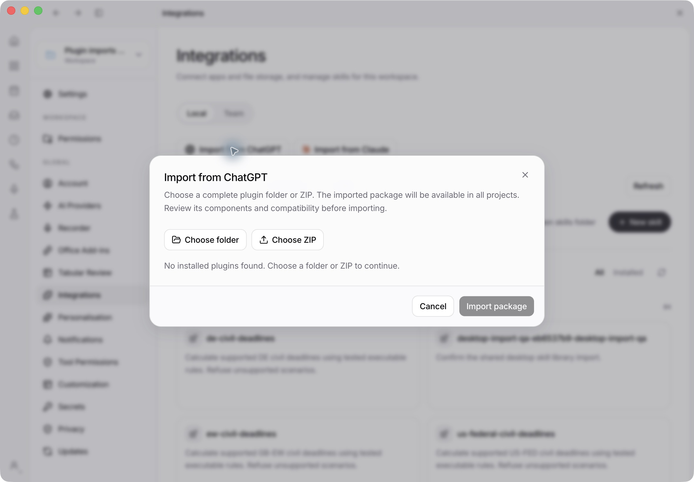

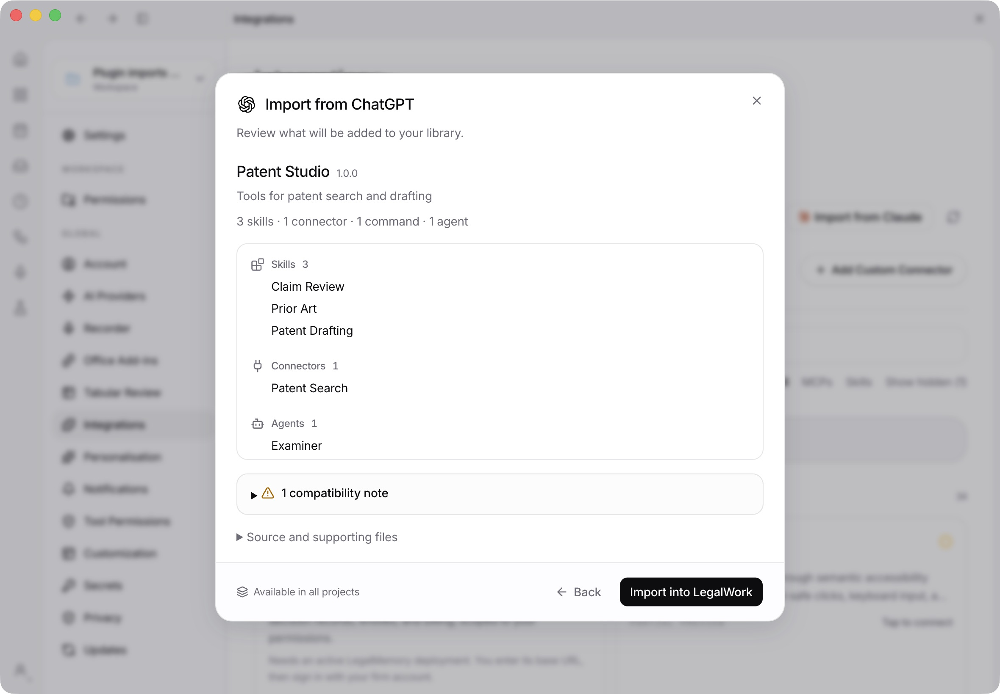

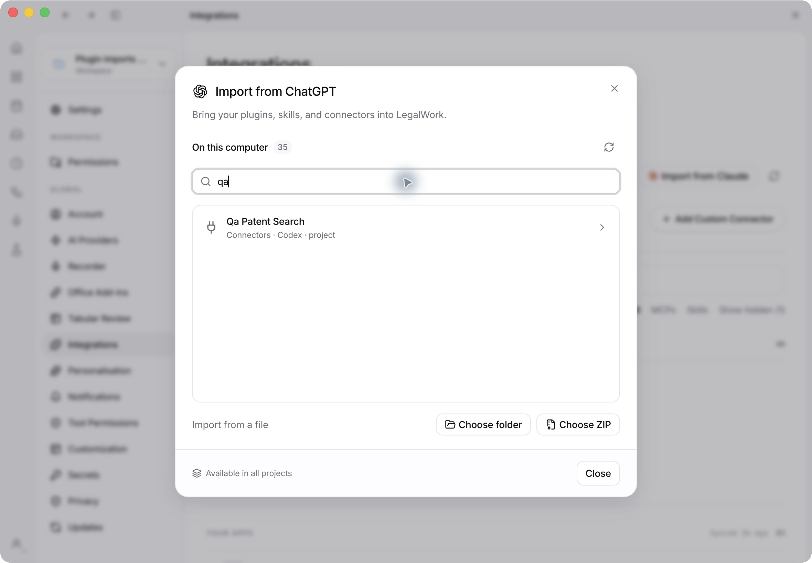

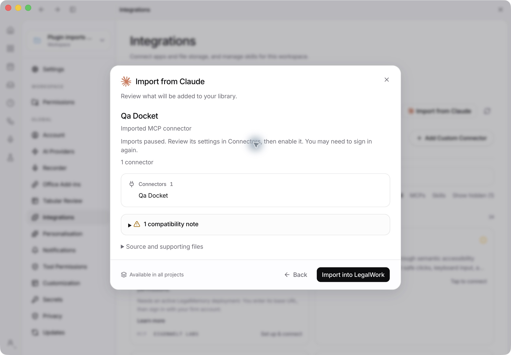

Native Electron verification found existing installations for both providers, filtered discovery by name and type, checked combined search/filter empty results and Back behavior, imported a Claude folder and a ChatGPT ZIP through the native pickers, and verified the resulting package cards and readable skill names. The ZIP fixture contained skills, a connector, an agent, a command and supporting files; its missing-credentials connector remained disabled with an explicit compatibility note. Standalone Claude and Codex MCP connectors were also discovered from project configuration, reviewed and imported into the paused connector library. A Node runtime smoke check verifies TOML discovery and header translation independently of the Bun test runner. No real MCP service was connected.

`pnpm --filter legalwork-server exec bun test src/connector-imports.test.ts src/plugin-imports.test.ts src/cloud-plugins.test.ts src/claude-plugin-bundle.e2e.test.ts src/runtime-opencode-config-store.test.ts src/validators.test.ts` exercises both providers, wrapped ZIP/folder imports, source assets and executable files, names/metadata, MCP precedence and exact arguments/environment/header values, global/project scope, cross-project removal, updates, rollback, source digests, ownership and malformed/oversized inputs.

`pnpm --filter @legalwork/app test`, app/server `typecheck`, app `test:i18n`, and app/server builds cover the UI and integration. Native Windows folder selection and real third-party MCP OAuth flows require platform/credential testing separately.

## Library redesign verification

Connectors, Skills and File storage keep the normal LegalWork category tabs, a fixed Import / Add / More toolbar, and search at the right. Connectors also has Browse directory immediately left of Import. Add opens each creation/connection form directly. All three libraries use a second row of plain **All / Personal / Team** tabs with an underline on the selected source. Source selection survives category changes and Refresh; search survives source changes. Successful imports return to All so newly imported personal items are visible.

All combines personal and team items; Skills also includes the expertise built into LegalWork. Personal shows the member's own items. Team shows the firm's available catalogue, including optional items that have not been added. Team skills now appear inline using the same rows as personal skills, without the separate Browse team skills browser. They come from the same Knowledge Hub catalogue as team connectors. Shared file storage still comes from the firm's storage settings. Source filtering does not grant ownership or editing rights over team-managed items.

All rows use icon, name, description and a three-dot action menu. View details comes first, then Edit, Export and Share when supported, followed by separated Remove. Sharing reviews only the selected item under its readable name. Team skill rows retain optional Add/Remove membership and the existing confirmation; installed team skills retain their read-only instructions/resource viewer. Automatic items stay managed by the firm. Connector account/enablement controls and storage membership remain in their details dialogs. Ready/Paused labels beside toggles, the sync indicator, unavailable expand arrows and the global project-availability badge are removed.

Skills More contains Import skill files, Imported packages, Open skills folder and Refresh. The package manager remains reachable without mixing whole packages into the skills source filter. Package components still appear in the appropriate main libraries. Workflows retain their existing controls and pagination.

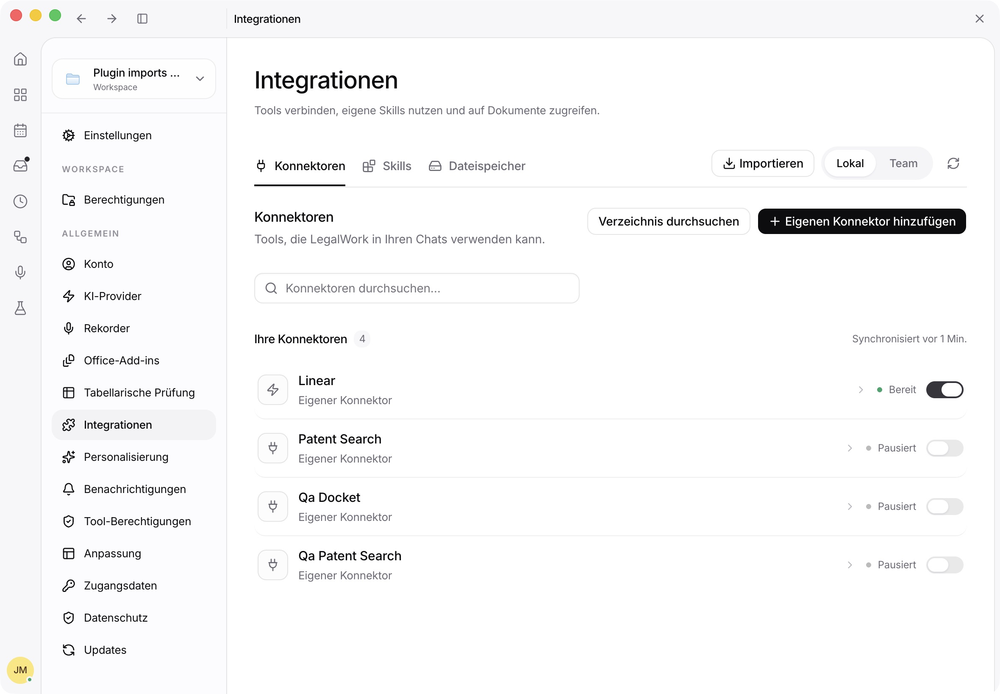

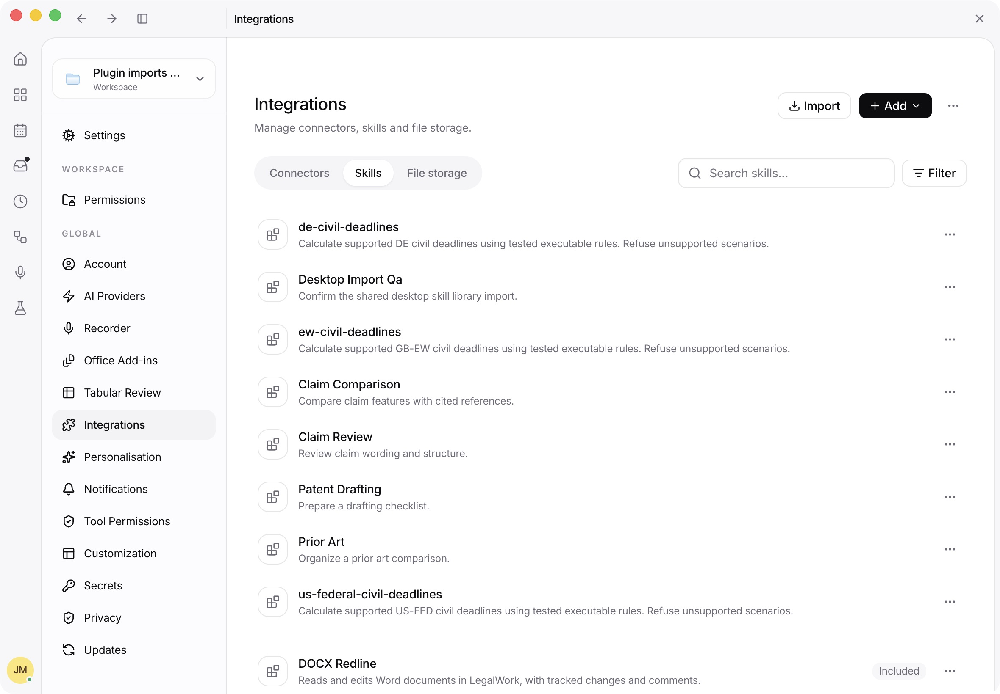

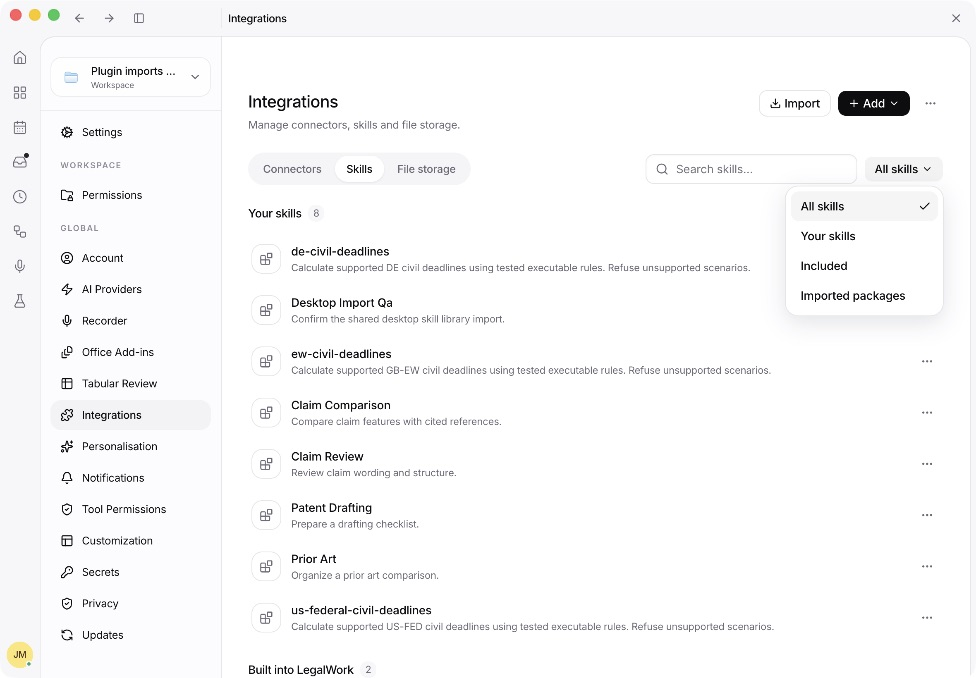

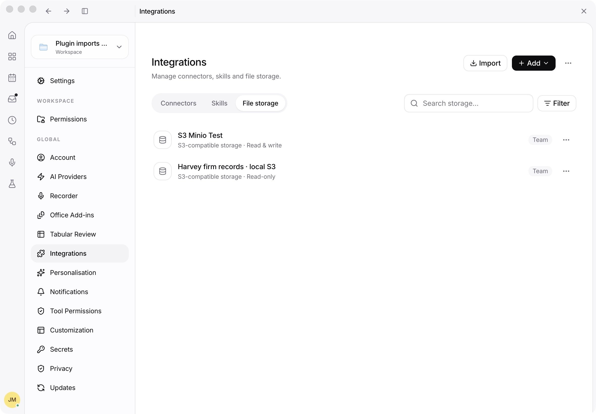

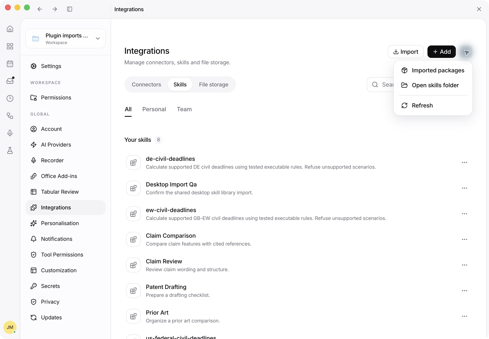

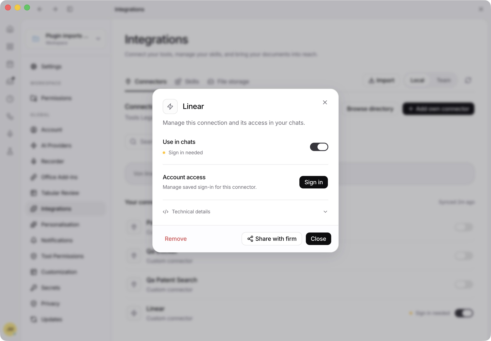

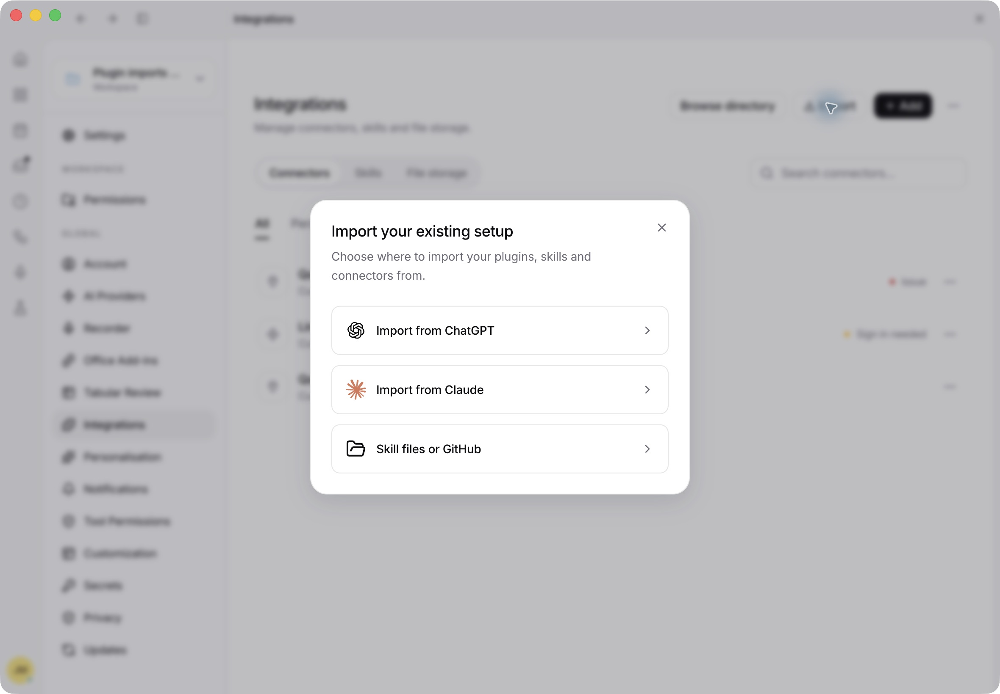

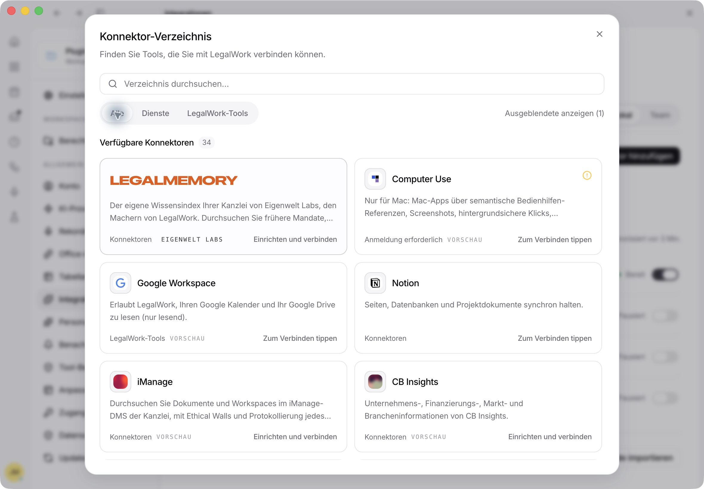

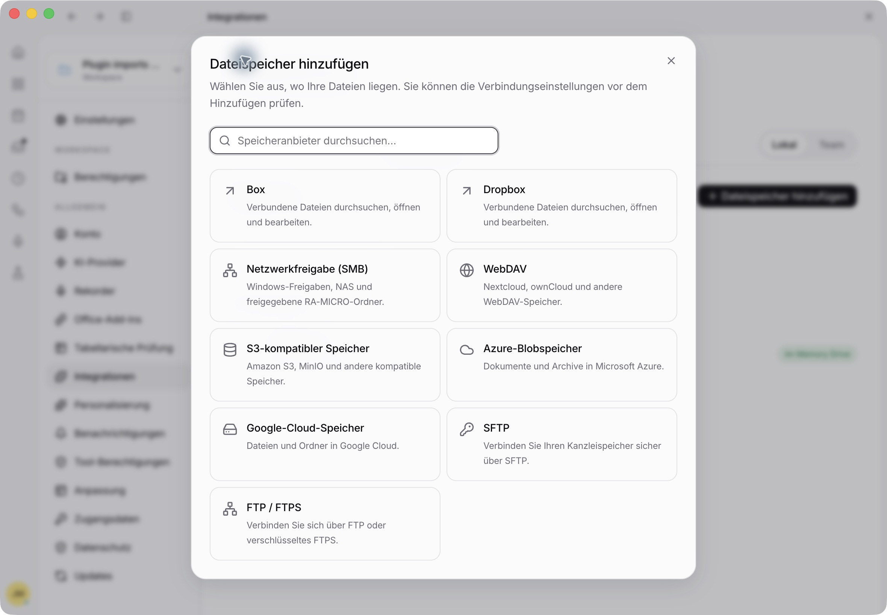

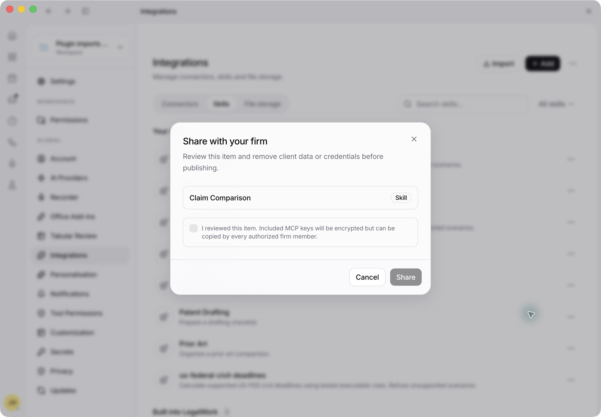

The final focused check, `pnpm --filter @legalwork/app exec bun test tests/integration-libraries.test.tsx tests/mcp-library.test.tsx tests/plugin-import-buttons.test.tsx`, passed 19 tests. The source-tab change passed `pnpm --filter @legalwork/app test` (948 tests across 146 files), `pnpm --filter @legalwork/app typecheck`, `pnpm --filter @legalwork/app build`, and `pnpm --filter @legalwork/app test:i18n` (5,747 keys per language). Regression coverage verifies source isolation for all three libraries, team connector/configuration deduplication, automatic ownership, optional connectors, the complete team skills catalogue appearing once, embedded team-skill search/empty results, built-in command search, and team storage access restrictions.

Native Electron verification covered all three source-tab rows, arrow-key focus and Enter activation, connector search retained across source changes, personal skills excluding built-ins, the inline Team skills empty state, the cleaned-up More menu, the imported-package manager, source selection retained across category changes, and the actual shared storage source excluded by Personal and included by All/Team. This account has no shared team skills, so populated catalogue and membership rendering were checked with cached server-view fixtures. No connection, team membership, credential or shared item was changed.

Earlier native import checks covered both providers' discovery, folder/ZIP pickers, component review, Change app and focus, complete Claude-folder/ChatGPT-ZIP imports and paused standalone MCP imports. Earlier library checks covered custom connector setup, directory search/filter/detail return, connector account/technical details, sign-out/removal confirmations (cancelled), built-in skill commands, imported package components, single-item sharing, and storage provider search/configuration/Change provider. The desktop dev server remains running for review.

The source-tab underline now sits closer to the text, with less bottom padding and no extra underline offset. This spacing adjustment was verified in Electron; the focused library/import tests passed again (19 tests).
