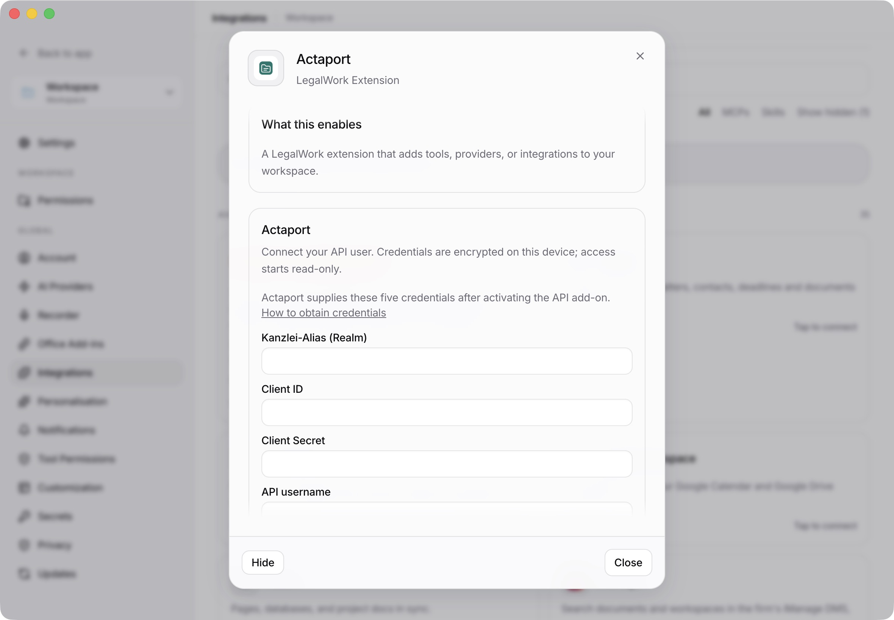
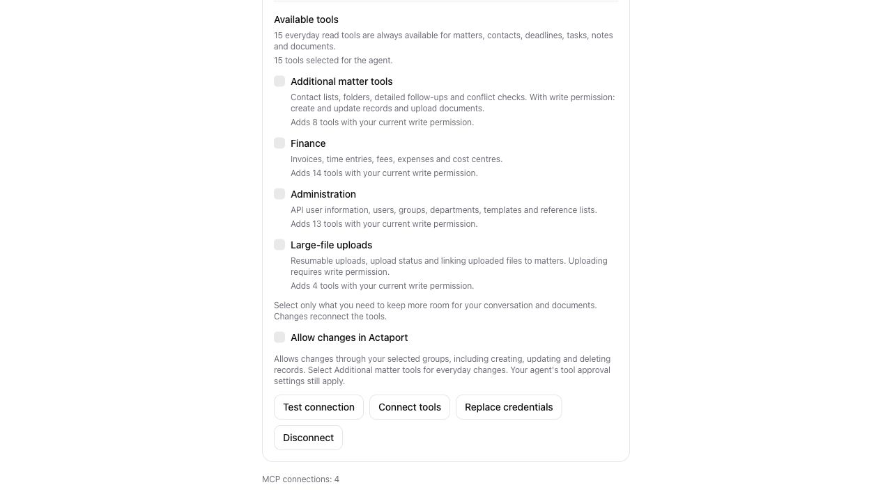

# Actaport integration evidence

Captured on 2026-10-13 and 2026-10-14 in the Actaport integration worktree.
No live Actaport account was used and no real credentials appear in these images.

## Desktop setup and icon

The running Electron development app shows the Actaport connection form and the
new folder icon. Credentials are empty; this demonstrates the desktop setup UI,
not successful authentication with Actaport.

## Optional tool groups

A browser fixture supplies a simulated saved connection to exercise the settings
UI. The screenshot shows the 15-tool default, four optional groups, and the
separate write-access setting. Save, test, group changes, reconnection, write
access, and disconnect were exercised with simulated credentials.

## Live acceptance still needed

1. In the desktop app, open Settings → Integrations → Actaport and connect an
   API-enabled test account using its realm, client ID, client secret, API
   username, and API password.
2. Find a matter and download/open a document; repeat a read after token expiry.
3. Enable an additional group and confirm the tool count changes. Revoke that
   group and confirm an already-running process rejects its calls.
4. With approved write access, exercise changes in a disposable matter. Disable
   write access and confirm subsequent writes are rejected.
5. Disconnect and confirm the saved credentials and token access are removed.

See [the package README](../../../packages/actaport-mcp/README.md) for the API
snapshot, credential handling, standalone setup, and automated verification.
