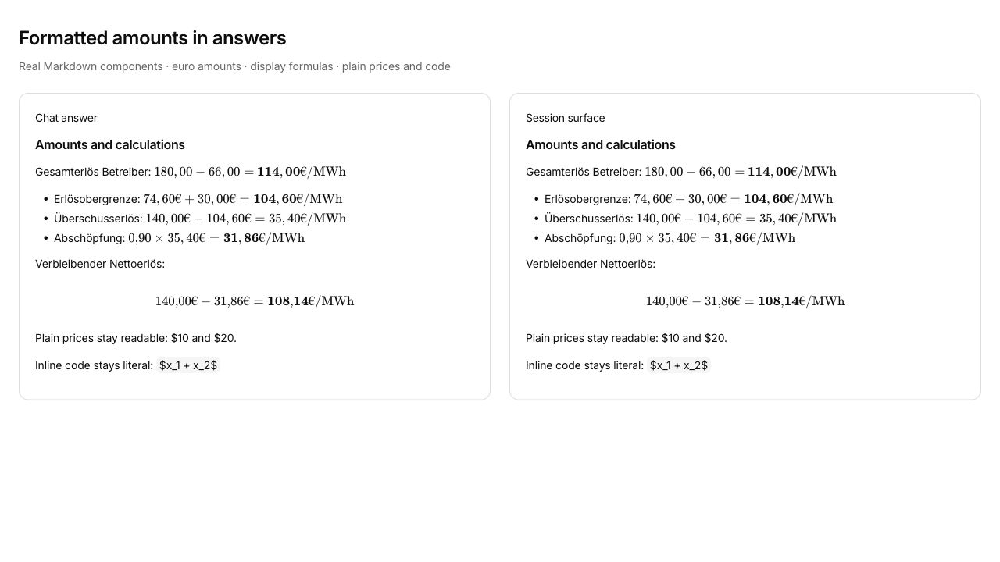

# Math in chat answers

Symptom: monetary calculations appeared as raw dollar delimiters and TeX commands in answers.

Root cause: both answer renderers used Marked without a math extension. KaTeX also needs an explicit `\euro` macro for the reported formulas.

Fix: share math tokenization and bundled KaTeX styles across both renderers and their asynchronous highlighting paths. Keep the existing HTML sanitizer, disable trusted TeX commands, bound macro expansion, and scroll display formulas within the answer.

Regression evidence: `apps/app/tests/markdown-math.test.tsx` renders the actual components. Before the fix, the four amount/streaming assertions failed; after the fix, all 11 cases pass. Five existing message-copy cases also pass.

Browser evidence: a local fixture mounted both actual components with synthetic euro calculations. Each rendered six formulas with accessible MathML, no formula errors, no page overflow, and no executable attributes or JavaScript links after sanitization. The screenshot shows that fixture, rather than an installed release or a live agent response.

## Reproduce

1. Run `pnpm --filter @legalwork/app exec bun test tests/markdown-math.test.tsx tests/message-copy.test.tsx`.
2. Start the app with `pnpm dev:ui` and open a chat. Ask the assistant to repeat a calculation using `$\mathbf{114,00\text{\euro/MWh}}$` and `$$140{,}00\text{\euro} - 31{,}86\text{\euro} = \mathbf{108{,}14\text{\euro/MWh}}$$`.
3. Confirm that the formulas show formatted numbers and euro signs. Reopen the chat and check the saved answer. Ordinary prices such as `$10 and $20` and code containing `$x + y$` should retain their text.

Validation: TypeScript, production UI build, and generated-help checks pass. The complete app suite has three Lexical initialization errors in the Markdown/wiki editor tests. Those three files also fail with the original answer renderer code restored; they do not depend on the math extension.

Status: DONE_WITH_CONCERNS (existing full-suite editor errors).
