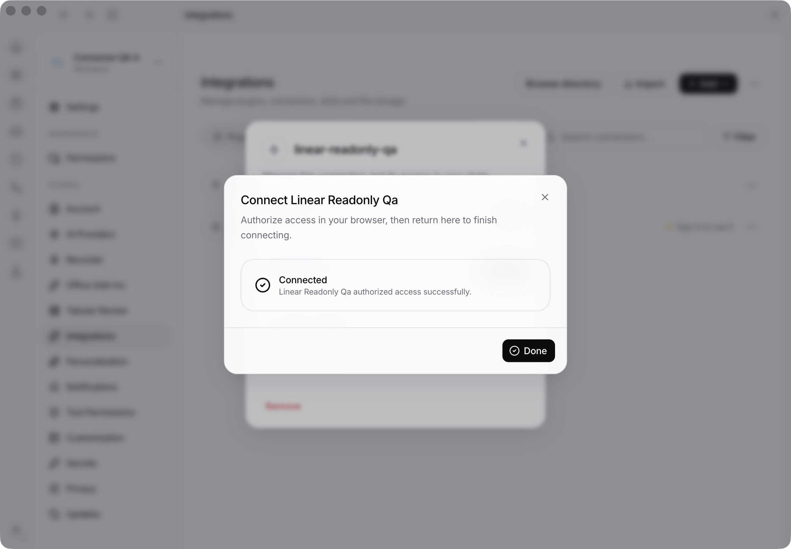

# Connector manager: Electron and live-provider QA

Tested on 19 October 2026, macOS arm64, Electron 43.7.5, stock OpenCode 1.18.29. The native engine SHA-256 was `9c46fd8b183c575453ce1b57a4d6500e34f5d19825e8f2653356415355992188`.

The Electron profile, server configuration, data and XDG directories were isolated. Two disposable projects shared one LegalWork server and connector vault. The installed LegalWork profile and its rotating grants were not reused.

## Credential handover revision

The shipped importer now transfers existing OpenCode OAuth grants before a new
managed engine starts. It uses matching URLs/client registrations, conservative
process checks, encrypted recovery copies in the existing vault, and persistent
cross-profile claims. Source cleanup preserves unrelated accounts. A generation
check inside the connection queue prevents transfer over a login/logout or
configuration change. Settings imports now commit the shared destination before
clearing workspace sources.

The new stock-engine reproduction signs in through an ordinary old engine,
stops it, imports its real `mcp-auth.json` entry, then runs two gateway-connected
engines. Agent tool calls, shared refresh, rebuild and logout/reconnection pass:
**30 assertions**, with no additional authorization grant during upgrade.

The real Linear grant from the disposable Electron profile was placed into the
legacy format after stopping that profile's owned runtime. The **shipped importer**
then transferred it using an explicit ownership check for this isolated source
file; other development apps remained running. Linear discovery returned **38
tools**, concurrent workspace token requests caused **one genuine rotating
refresh**, and `list_teams` succeeded after manager restart. **Zero browser
sign-ins** were required. This validates the importer with a real provider; the
stock-engine reproduction separately validates the actual old engine's format.

Regression coverage includes interrupted backup/retirement/activation, partial
multi-connector completion after token rotation, concurrent logout, unreadable
vaults, provider/client mismatch, name collisions, and another profile trying to
adopt a restored old grant. LegalMemory appliance features share the new token
owner rather than reading retired credentials from the old file.
An unreadable legacy file is preserved and transfer is deferred; it does not
prevent the app from starting and offering a fresh sign-in.

- Focused server/runtime/storage/appliance checks: **291 passed, 5 skipped**,
  1,614 assertions across 24 files.
- Native engine upgrade: **1 passed**, 30 assertions, two consecutive runs after
  fixing fixture setup.
- Server TypeScript check, app TypeScript check and server build passed.

The first native upgrade fixture killed its fresh old engine while OpenCode's
background package installs held locks. The new engine then waited for those
stale locks. The fixture now loads an inert plugin so the old engine finishes
that setup before sign-in and shutdown. No OpenCode patch is involved. The
previous vault-reuse revision subsequently passed both Linux and macOS CI;
the handover revision must pass its own checks.

## Shared-vault revision

MCP now uses the existing `OAuthVault`, `storage-oauth.vault` and encryption key,
with a separate `managed-mcp` entry. The independent MCP encryption codec,
desktop key provider and key file have been removed. The existing file format
and key policy are unchanged: `LEGALWORK_ENCRYPTION_KEY` or an adjacent key file
with mode 0600. This revision uses the existing vault policy, including its
file-based key storage; it does not add operating-system keychain protection.

- Shared-vault regression: **111 passed**, 780 assertions. Covers existing
  storage grants and built-in connector capabilities surviving concurrent MCP
  refresh and restart, key reuse, custom storage locations, cross-process MCP
  ownership, and unreadable-key preservation.
- Broader connector/runtime regression: **138 passed, 5 skipped**, 679 assertions.
- Server build and app TypeScript check passed.
- The disposable Electron profile's two MCP connections, including its real
  Linear OAuth grant, were copied into the shared vault using an unshipped
  one-time helper before restarting. Both projects discovered the real providers
  and completed Cloudflare searches and Linear `list_teams` calls without another
  sign-in. The hosted Eigenwelt Model API remains configured.
- Scanned **16,409** disposable-profile files: no current provider token or
  client-secret plaintext copies. Shared vault and its key file are mode 0600.
- The native two-engine integration passed twice consecutively with 26 assertions
  per run after bounding startup health probes, and on a diagnostic rerun. Earlier ordinary runs
  timed out at 90 seconds without diagnostics. The previous branch revision also
  timed out in Linux CI. Startup health requests now have a one-second timeout
  and the polling loop has a wall-clock deadline. Both Linux and macOS CI later
  passed on that revision; the newer handover reproduction is described above.

The matrix and screenshots below document the initial live-provider run. That
run preceded consolidation into the existing vault; its separate OS-protected
MCP key implementation has since been removed. The shared-vault checks above
were repeated on the refactored implementation.

## Real providers and execution

- [Cloudflare Documentation MCP](https://github.com/cloudflare/mcp-server-cloudflare): `https://docs.mcp.cloudflare.com/mcp`, two public tools.
- [Linear read-only MCP](https://linear.app/docs/mcp): `https://mcp.linear.app/mcp/readonly`, 38 read tools, genuine browser OAuth and provider refresh tokens.
- A deterministic local OpenAI-compatible model selected tools. The engine, gateway, provider discovery, OAuth exchanges, refreshes and tool results were real. No paid model or external write operation was needed.

Twenty-five actual agent tool invocations completed: one task entered in the native Electron UI and six rounds of four concurrent tasks across two projects and both services. The gateway was also exercised directly using SDK clients; these calls are separate from the agent invocation count.




## Live checks

| Scenario | Observed result |
| --- | --- |
| Add an anonymous remote connector in Electron | Probe and save work; real Cloudflare search returns documentation |
| Add OAuth connector and authorize in browser | Linear connects, with no engine-owned OAuth grant |
| Discovery and read calls in both projects | Both discover 2 Cloudflare tools and 38 Linear tools; documentation search and `list_teams` succeed |
| Four simultaneous clients after expiry | Exactly one genuine Linear refresh; access and refresh tokens both rotate |
| Upstream 401 | One genuine refresh and a successful authenticated retry |
| Temporary token endpoint network failure | Request fails; grant stays saved; later genuine refresh succeeds |
| Temporary upstream connection failure | Request fails; later call reconnects without another browser sign-in |
| Cancel a Cloudflare request | Other project's request completes; original project remains usable |
| Disable shared connector | Both existing gateway sessions lose access |
| Enable it again | Fresh session works using the retained grant |
| Rebuild both engine instances | Both keep working with correctly scoped gateway URLs; no new OAuth code exchange |
| Use a gateway bearer in another workspace | HTTP 401 |
| Use a gateway bearer for account management | HTTP 401 |
| Force-kill Electron after token rotation, then restart | Store ownership recovers; encrypted rotated grant opens and real reads work without sign-in |
| Log out while a successful provider refresh response is delayed | Late tokens are discarded; both projects require sign-in; no token resurrection |
| Sign in again through Electron | Browser OAuth completes and both services pass another twelve agent calls |
| Inspect persisted credential locations | 16,331 test-profile files scanned for the current provider access/refresh/client secrets; zero plaintext matches; vault and OS-protected key file both mode 0600 |

Fault injection and inspection ran in an unshipped Electron entry wrapper, confined to the disposable profile. Expiry was advanced by changing the vault record's expiry metadata. The 401 and network failures were injected at the manager's fetch boundary; token exchanges and successful tool calls still went to the real providers. The logout race delayed delivery of a genuinely successful refresh response, after Linear had already issued the new token.

## Bugs found and fixed

1. The renderer saved a connector through LegalWork, then tried to send its provider configuration directly to OpenCode. The sandbox ownership guard rejected the second write with HTTP 403, so the UI falsely reported failure. The renderer now only observes engine status after the server registers the connector. The UI regression fixture rejects all direct engine MCP writes.
2. Startup unnecessarily probed engines when no connectors existed, racing workspace activation and adding requests. Empty registries now skip that probe. Firm-only connections still rebind, covered by a regression test. Startup readiness probes also stop when the manager shuts down.
3. Three older integration fixtures assumed plaintext engine configuration. They now verify the vault-backed descriptor, hydrated management view and derived gateway configuration.

## Automated checks

- Focused server regression: **160 passed, 5 skipped**, 772 assertions, 16 files. The skipped tests are older optional native recovery tests; the new native engine test ran separately.
- Stock-engine integration: **1 passed**, 26 assertions, two real unmodified engine processes.
- App connector regression: **81 passed**, 276 assertions; changed connection-store suite also rerun with all direct engine writes rejected.
- App TypeScript check and server build passed. The initial desktop vault-key tests passed before that implementation was removed in the shared-vault revision.
- Full server suite: **2,341 passed, 68 skipped, 2 failed**. The same two failures reproduced on an archive of base `e3900fa44b0215167da1845637ccc3c9f26a601e`, using the same Bun 1.3.14 and installed dependencies: `serve-node.test.ts` streaming-error handling and `wiki/store.test.ts` graph-poll invalidation. Neither implementation nor test file differs from the base. The full local suite is therefore not green.

Re-run the core automated checks from the repository root:

```sh
pnpm --filter @legalwork/app typecheck
pnpm --filter legalwork-server build
OPENCODE_TEST_BINARY=/absolute/path/to/stock/opencode \
  bun test --preload ./apps/server/test-preload.ts apps/server/src/mcp-manager.engine.e2e.test.ts
bun test --preload ./apps/server/test-preload.ts apps/server/src/mcp-manager.test.ts \
  apps/server/src/file-storage/oauth/session.test.ts apps/server/src/connectors/connectors.test.ts \
  apps/server/src/connectors/local-oauth.test.ts
bun test apps/app/tests/mcp-oauth-flow.test.ts apps/app/tests/mcp-auth-identity.test.ts \
  apps/app/tests/mcp-connect-state.test.ts apps/app/tests/mcp-configuration.test.tsx \
  apps/app/tests/connections-remove-mcp.test.ts apps/app/tests/mcp-logout-truthfulness.test.ts
pnpm --filter legalwork-server test
```

To reproduce the manual flow, launch `pnpm dev:electron` with a new `LEGALWORK_ELECTRON_USERDATA`, `LEGALWORK_SERVER_CONFIG`, `LEGALWORK_DATA_DIR` and XDG directories. Create two projects; add the two provider URLs under Settings → Integrations → Connectors. Complete Linear OAuth, issue read-only tasks from both projects, restart the app, disable/enable, log out and sign in again. Test-specific harness scripts and redacted result records remain in the ignored local `artifacts/connector-manager-live-qa` directory; they are not part of the shipped app.

## Limits

Real-provider coverage is macOS with Linear and Cloudflare. Firm Hub behavior, terminal OAuth errors, opaque provider URLs, legacy SSE and the remaining protocol cases use the controlled integration fixtures. Windows/Linux and real firm deployments were not exercised interactively in this run. Built-in Google/Microsoft adapters are outside this custom remote MCP manager path; preservation of their shared vault entries is covered by the regression tests.
