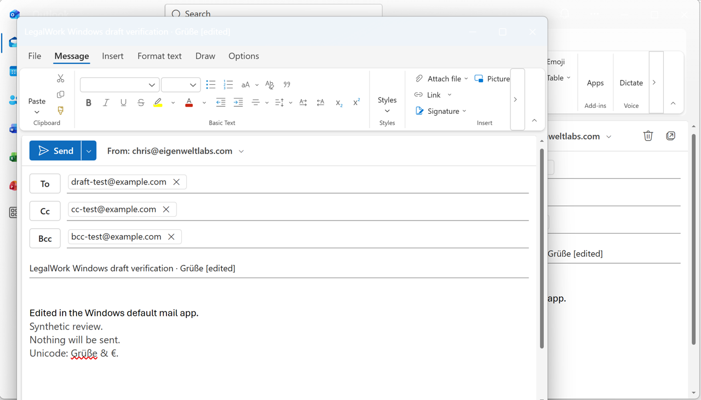
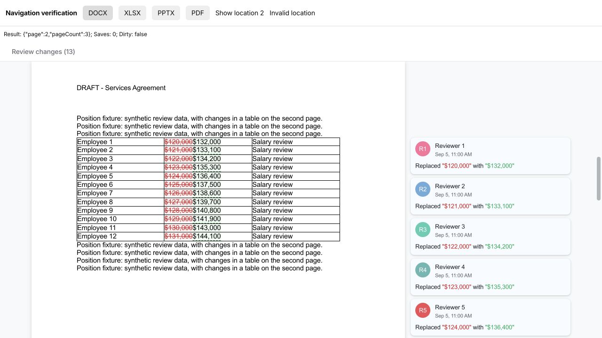
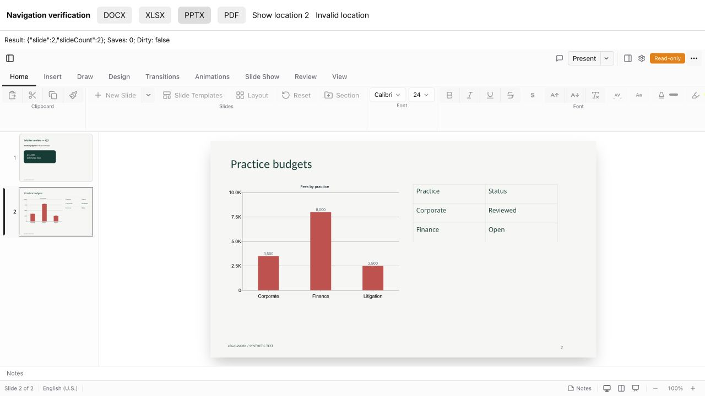
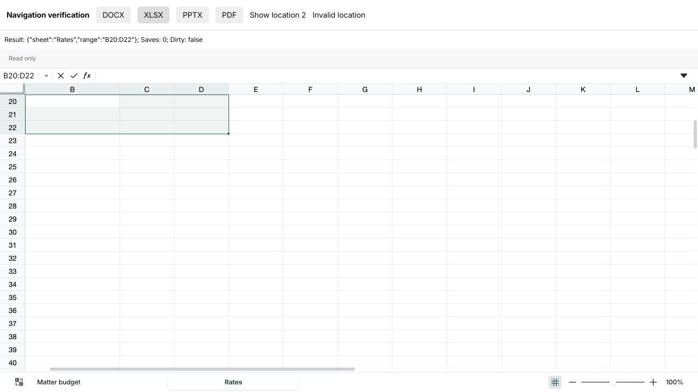
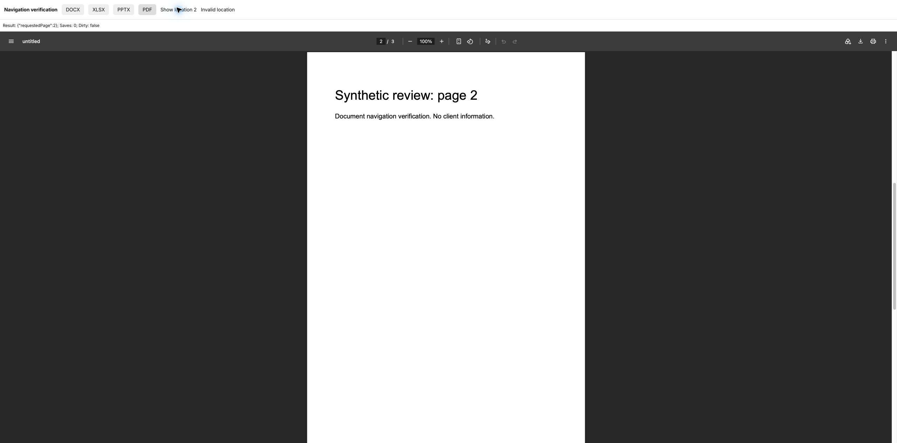
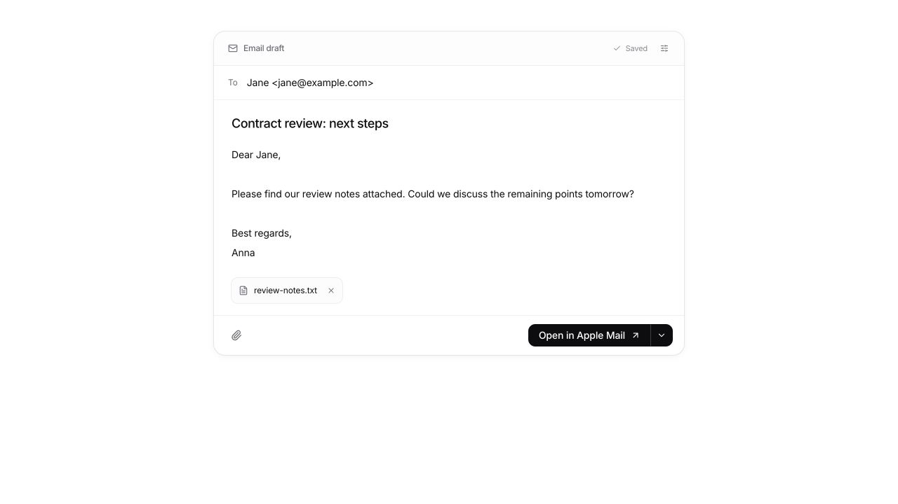

# Editable drafts and requested document navigation

The agent can present a draft directly in chat. Email shows the recipient,
subject, message and attachment chips. Event cards show the title, a date tile,
time, and any supplied location, guests and notes. Optional fields stay behind
options controls; the date block expands when the user wants to change it.
Save appears only while the draft has edits. Opening or downloading also saves
pending edits first.

On macOS, Open in Apple Mail creates and saves a visible compose window with
To, Cc, Bcc, subject, message text and attachments. Files are downloaded through
the workspace API and staged privately for Mail, so remote project paths never
become local attachment paths. The temporary copies are removed after handoff.
The helper has no send action. HTML and custom Reply-To remain in the EML
download; the card explains this when either field is populated. Other desktop
platforms use a mailto compose link. The main action and its menu form one split
button. On macOS, the menu has separate Outlook app and Outlook web actions.

The native Outlook action creates an outgoing message with its `make` command,
adds recipients and attachments, and opens its editable composer. Outlook
persists the draft itself; its scripting `save` command exports a file and is
not used. The helper checks that every attachment was imported before opening.
Outlook uses its selected sending account. Native
mail actions use plain text; advanced fields remain in the EML export.
Both native mail actions require macOS Automation consent.

On Windows, the primary **Open in Mail** action passes a `mailto:` compose link
to Electron's `shell.openExternal`, respecting the user's default mail app.
It supplies To/Cc/Bcc, subject and plain-text body. This protocol cannot carry
attachments; the card shows an attachment notice when needed, and `.eml`
retains the full draft. The dropdown also offers **Open in classic Outlook**,
which creates and saves an editable COM mail item with attachments imported
by value before the staging files are deleted. New Outlook does not expose
that COM API, so it uses the default-app or web action. No helper sends mail.
PowerShell receives message data as UTF-8 JSON on stdin, never as code.

The implementation imports the patch supplied in
`legalwork-email-calendar-drafts.zip` and includes review corrections:

- Preserve quoted commas and complete international display names in EML
  headers. Mailto recipients use address specs, following
  [RFC 6068](https://www.rfc-editor.org/rfc/rfc6068#section-2).
- Clear the optional HTML body when the visible message is edited, preventing
  an email app from preferring stale text over the user's correction.
- Preserve the intended day when changing an all-day event to a timed event.
  Clearing a date does not change the input mode or crash the card.
- Register each mounted card separately so a clean duplicate cannot hide
  another card's unsaved edits.
- Exercise actual HTTP authorization, workspace boundaries, read-only mode,
  optimistic revisions, file downloads and agent-tool routing.
- Bundle draft schemas into the Node server so Electron can load the routes
  without the workspace TypeScript sources. The build smoke test rejects
  unbundled workspace dependencies and runs in CI.

## Validation

Run from the repository root with Node 24, pnpm and Bun:

```sh
pnpm install --frozen-lockfile
pnpm test:drafts
pnpm --filter @legalwork/app test
pnpm --filter @legalwork/app typecheck
pnpm --filter legalwork-server typecheck
pnpm --filter legalwork-server build
pnpm test:drafts:build
pnpm --filter legalwork-server exec bun test src/email-drafts/routes.test.ts src/opencode-plugins/legalwork-draft-tools.test.ts src/opencode-plugins/legalwork-calendar-tools.test.ts src/legalwork-runtime-config.test.ts src/opencode-plugins/legalwork-extensions-preview.test.ts
node scripts/i18n-audit.mjs --ci
pnpm --filter @legalwork/desktop test
pnpm --filter @legalwork/desktop typecheck:electron
pnpm --filter @legalwork/desktop check:electron
```

Results after merging `origin/dev`: 21 draft tests, 1,213 app tests, 20
HTTP/plugin/runtime tests and 29 document-control plugin tests passed.
App, server and Electron typechecks, the server build, Node build smoke test,
i18n audit and Electron bridge coverage check passed. Desktop tests: 232 passed,
3 skipped on macOS. A Windows CI job now runs portable draft tests and the native
mail tests, including the production PowerShell program with a COM test double.

Electron launched on macOS with the existing development profile and loaded
saved workspaces and sessions without a module-resolution error. Apple Mail
showed a saved, editable synthetic draft with To/Cc/Bcc, Unicode text and an
intact attachment. Outlook 16.113.4 opened a native synthetic draft with the same
fields. The subject and body were edited, then the draft was closed and reopened
from Drafts. Quick Look showed the exact attachment bytes after the temporary
source copy was removed. No email was sent; synthetic drafts were moved to
Deleted Items afterward. Outlook templates silently omitted attachments on this
Mac, so the implementation uses native message creation instead. Automation
consent was enabled with the user's approval.

Windows 11 24H2 VM verification: all 13 native-mail tests passed, including the
actual PowerShell program with a COM test double. The VM has new Outlook
1.2026.922.300 as its default mail handler and no classic Outlook COM registration.
The classic-Outlook helper correctly reported that limitation. The production
compose-link helper and Electron 43.7.5 `shell.openExternal` handoff returned
success with the synthetic To/Cc/Bcc, Unicode subject and multiline body. After
the user completed initial sign-in, Windows opened an editable composer in its
default app, new Outlook. To/Cc/Bcc, Unicode subject/body and line breaks
were correct. The subject and body were edited, saved, closed and reopened from
Drafts with those edits preserved. This exercised the production URL helper and
Electron handoff from a small isolated Electron harness. The default-app route
uses `mailto:` and cannot attach files. Real classic-Outlook COM attachment
import remains unverified because that client is not installed. No message was
sent.



## Requested document navigation

`inapp_documents_navigate` shows a PDF or Word page, PowerPoint slide, or Excel
sheet/range. Its tool description and fixed agent instructions say to use it
only when the user explicitly asks to navigate or show a location. Reading,
analyzing, summarizing or citing a document is not a navigation request.
The tool takes only `path` and `target`; no request quote or extra confirmation
is required. It validates the calling session, exact active path, file format
and destination, and is unavailable to scheduled agents.

Example destinations, after listing/selecting the intended document:

```json
{"path":"contract.pdf","target":{"kind":"page","page":5}}
{"path":"contract.docx","target":{"kind":"page","page":5}}
{"path":"presentation.pptx","target":{"kind":"slide","slide":3}}
{"path":"budget.xlsx","target":{"kind":"cells","sheet":"Rates","range":"B20:D22"}}
```

Navigation works in read-only views and does not edit or save. DOCX pages refer
to the current rendered layout. PDF requests reload the built-in viewer with a
page destination, so zoom/search state can reset. PDFium owns page-count bounds;
the result reports the requested page, not a verified current page.

Browser checks used actual viewer components with synthetic repository fixtures:
Word page 2, PowerPoint slide 2, Excel `Rates!B20:D22`, and PDF page 2. Each showed
the requested destination with zero saves and no dirty state. Out-of-range slides
and cells were rejected. These component checks were separate from the server
routing tests; a live model was not used for the navigation checks.






## Browser verification

The screenshots use synthetic data in an isolated temporary workspace. They
render the actual React cards against the actual LegalWork server API; agent
output was seeded, rather than generated by a live model. Checked in the
browser's wide and narrow layouts:

1. Edit and save an email, then reload the card and confirm the saved text.
2. Change Bcc through the options control, collapse it, save, and reload.
3. Confirm the unsaved-navigation guard still catches edits with a second
   card for the same draft mounted.
4. Convert an event to all-day, clear and restore the date, and convert back.
   A one-day event becomes 09:00-10:00 on that same day.
5. Download EML and ICS through the card menus. Parse the downloaded EML with
   Python's email parser: corrected body, no stale HTML, correct quoted
   recipient and intact attachment bytes. Inspect the ICS for the correct
   UTC start/end, guests and organizer.
6. Save a concurrent revision through the API, then attempt to save the
   browser's stale draft. The conflict is shown and its local text remains.
   Explicit reload recovers the latest saved revision.





## Reproduce in the app

```sh
pnpm dev:electron
```

1. Open a local test project and add a synthetic `review-notes.txt` file.
2. Ask: "Draft an email to Jane <jane@example.com> about reviewing the contract.
   Attach review-notes.txt and show the editable email card."
3. Edit the subject/message, open the options control to edit Cc/Bcc, and save.
   From the action menu, download `.eml` and inspect it in an email app.
4. Ask: "Draft a calendar event for 14 October 2026 from 14:00 to 15:00 in
   Europe/Berlin, titled Contract review, with jane@example.com as a guest."
5. Expand the date block, change the time, save, and download `.ics`.
6. Open another view of the same draft, save a change in one view, and attempt
   to save an older revision in the other view. Confirm that it reports a
   conflict without discarding local edits.

Screenshots are provided instead of a recording because the browser tooling
used for this review exposes still captures. Native Calendar imports and
signed-in Gmail, Google Calendar and Outlook web compose screens were not exercised.
Web links omit attachments and some advanced fields; the download preserves
those details. This feature does not connect accounts or send messages or
invitations.
