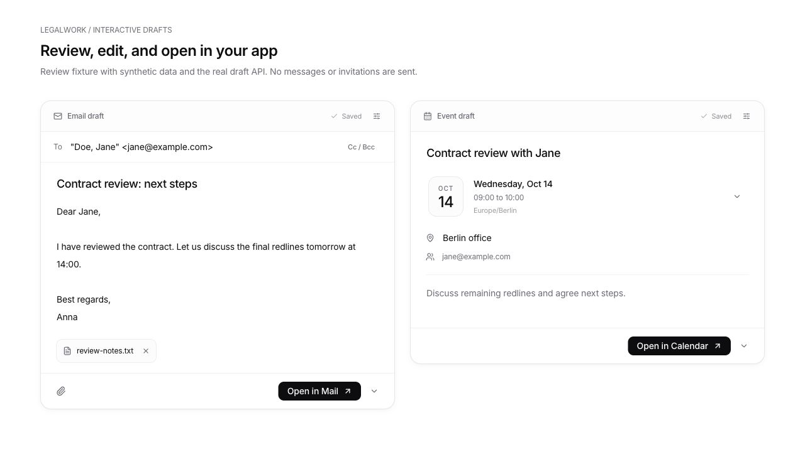
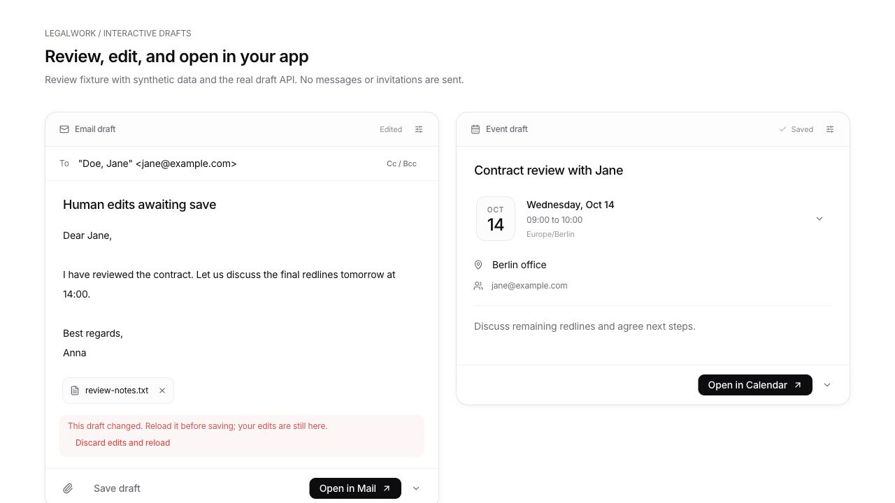

# Editable email and calendar drafts

The agent can present a draft directly in chat. Email shows the recipient,
subject, message and attachment chips. Event cards show the title, a date tile,
time, and any supplied location, guests and notes. Optional fields stay behind
options controls; the date block expands when the user wants to change it.
Save appears only while the draft has edits. Opening or downloading also saves
pending edits first.

The implementation imports the patch supplied in
`legalwork-email-calendar-drafts.zip` and includes review corrections:

- Preserve quoted commas and complete international display names in EML
  headers. Mailto recipients use address specs, following
  [RFC 6068](https://www.rfc-editor.org/rfc/rfc6068#section-2).
- Clear the optional HTML body when the visible message is edited, preventing
  an email app from preferring stale text over the user's correction.
- Preserve the intended day when changing an all-day event to a timed event.
  Clearing a date does not change the input mode or crash the card.
- Register each mounted card separately so a clean duplicate cannot hide
  another card's unsaved edits.
- Exercise actual HTTP authorization, workspace boundaries, read-only mode,
  optimistic revisions, file downloads and agent-tool routing.

## Validation

Run from the repository root with Node 24, pnpm and Bun:

```sh
pnpm install --frozen-lockfile
pnpm test:drafts
pnpm --filter @legalwork/app test
pnpm --filter @legalwork/app typecheck
pnpm --filter legalwork-server typecheck
pnpm --filter legalwork-server build
pnpm --filter legalwork-server exec bun test src/email-drafts/routes.test.ts src/opencode-plugins/legalwork-draft-tools.test.ts src/opencode-plugins/legalwork-calendar-tools.test.ts src/legalwork-runtime-config.test.ts
node scripts/i18n-audit.mjs --ci
```

Results: 21 draft tests, 1,210 app tests and 20 HTTP/plugin/runtime tests passed.
Both typechecks, the server build and the i18n audit passed.

## Browser verification

The screenshots use synthetic data in an isolated temporary workspace. They
render the actual React cards against the actual LegalWork server API; agent
output was seeded, rather than generated by a live model. Checked in the
browser's wide and narrow layouts:

1. Edit and save an email, then reload the card and confirm the saved text.
2. Change Bcc through the options control, collapse it, save, and reload.
3. Confirm the unsaved-navigation guard still catches edits with a second
   card for the same draft mounted.
4. Convert an event to all-day, clear and restore the date, and convert back.
   A one-day event becomes 09:00-10:00 on that same day.
5. Download EML and ICS through the card menus. Parse the downloaded EML with
   Python's email parser: corrected body, no stale HTML, correct quoted
   recipient and intact attachment bytes. Inspect the ICS for the correct
   UTC start/end, guests and organizer.
6. Save a concurrent revision through the API, then attempt to save the
   browser's stale draft. The conflict is shown and its local text remains.
   Explicit reload recovers the latest saved revision.





## Reproduce in the app

```sh
pnpm dev:electron
```

1. Open a local test project and add a synthetic `review-notes.txt` file.
2. Ask: "Draft an email to Jane <jane@example.com> about reviewing the contract.
   Attach review-notes.txt and show the editable email card."
3. Edit the subject/message, open the options control to edit Cc/Bcc, and save.
   From the action menu, download `.eml` and inspect it in an email app.
4. Ask: "Draft a calendar event for 14 October 2026 from 14:00 to 15:00 in
   Europe/Berlin, titled Contract review, with jane@example.com as a guest."
5. Expand the date block, change the time, save, and download `.ics`.
6. Open another view of the same draft, save a change in one view, and attempt
   to save an older revision in the other view. Confirm that it reports a
   conflict without discarding local edits.

Screenshots are provided instead of a recording because the browser tooling
used for this review exposes still captures. Native Mail/Calendar imports and
signed-in Gmail, Google Calendar and Outlook compose screens were not exercised.
Web links omit attachments and some advanced fields; the download preserves
those details. This feature does not connect accounts or send messages or
invitations.
