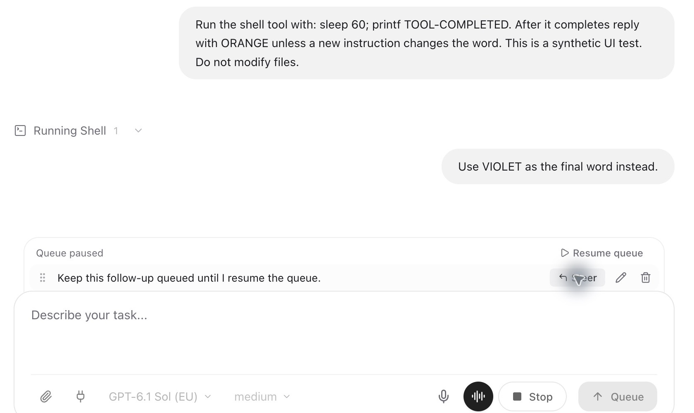
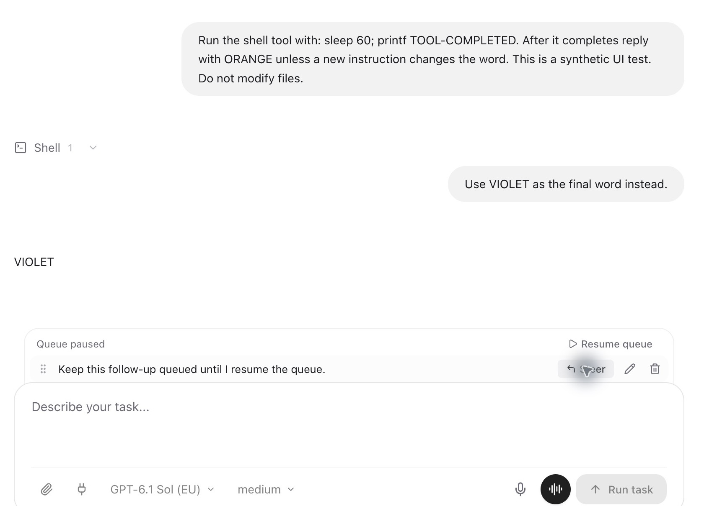

# Queue steering verification

Verified on 29 October 2026 with the installed OpenCode 2.1.4 engine and the standard LegalWork Electron development profile at `http://localhost:5173`. The UI identity endpoint confirmed this checkout's `apps/app` directory. Tests used a synthetic chat in the existing Background UI Tests project.

## Live engine and UI

1. Started a task with a running shell delay and queued two ordinary messages. Paused the queue, then clicked **Steer** on the second message.
2. The engine accepted that stable message ID with `delivery: "steer"`. The tool completed normally and the final answer followed the steered instruction. The other entry remained queued and paused.
3. Repeated with a prepared attachment and hidden context, while the saved queued model/agent differed from the active chat. The reply contained both verification tokens. Native history contained one user message, and the active model and agent were unchanged.
4. Exercised the admission race by first admitting the same message ID into the native inbox with `delivery: "queue"`. The server queue action promoted it to `steer`; it did not admit another message.
5. Checked the immediate rendering fix: while the tool was still running, the native inbox contained the accepted steer and native history contained zero copies, but the user bubble was already visible. On delivery, history contained exactly one copy and the reply was `VIOLET`.

The remaining synthetic queue entry was removed after verification. No user queue entries or profile settings were changed.





## Automated coverage

- `apps/server/src/queue-steer.test.ts`: installed-client API signatures, prepared payload preservation, active model/agent, pause and order, duplicate clicks, edit leases, stale content, ordinary unresolved delivery, admission races, already-delivered reconciliation, idle boundary, lost responses, restart recovery and definite failures.
- Existing queue, native delivery/command, assistant queue, execution gate and session read tests remain passing.
- `apps/app/tests/queued-messages-panel.test.tsx`: prompt eligibility and disabled states, including paused queues.
- `apps/app/tests/assistant-outgoing-messages.test.ts`: immediate accepted bubbles from shared state, attachment visibility, hidden context exclusion, stable native identity, history deduplication and retention across queue/history timing differences.
- Wiki skill and migration tests verify lookup-before-external-research instructions and preservation of customized wiki guidance.

Lost-response and restart fault injection were automated against the installed native client's HTTP interface. Live engine testing covered active steering, queue promotion, attachment/context preservation and immediate UI rendering. A real process crash during admission, simultaneous physical windows and a live legal research model's compliance with wiki reuse were not manually exercised.

## Reproduction

In a test chat, start a task that takes time, send two follow-ups, pause the queue and choose **Steer** on the second follow-up. It should appear in the conversation once accepted, while the task continues. Its instruction should affect the next model step, and the first follow-up should remain paused. Changing the queued message's saved model or agent must not change the active chat when it is steered.

Run server coverage from `apps/server`:

```sh
pnpm dlx bun@latest test src/session-message-queue.test.ts src/queue-steer.test.ts src/native-command-control.test.ts src/native-delivery.test.ts src/assistant-session-queue.test.ts src/session-execution-gate.test.ts src/session-read-model.e2e.test.ts src/wiki/legal-research.test.ts src/wiki/suggestions.test.ts src/wiki/store.test.ts src/wiki/write-approval.e2e.test.ts src/opencode-plugins/legalwork-wiki-tools.test.ts
```

Run UI coverage from `apps/app`:

```sh
pnpm exec bun test tests/assistant-outgoing-messages.test.ts tests/queued-messages-panel.test.tsx tests/queued-order.test.ts tests/assistant-chat-presentation.test.tsx tests/wiki-suggestions.test.ts tests/wiki-markdown-syntax.test.ts tests/wiki-page-heading.test.ts
```

Server tests use Bun 1.4.4 through pnpm because the locally installed Bun 1.3.9 cannot load the installed HTTP transport. No package or lockfile changes are required.
