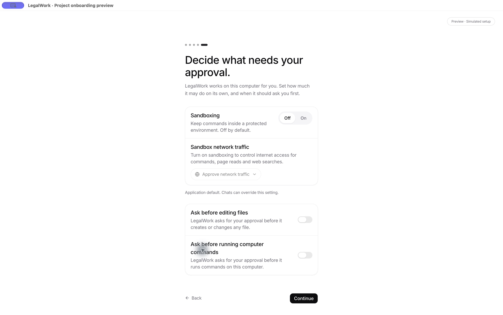
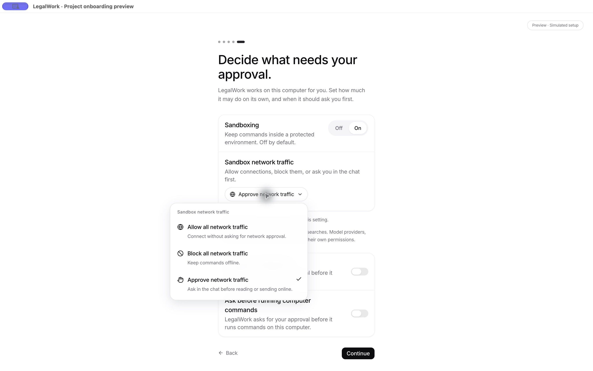

# Sandbox onboarding and workspace integration

The permissions step follows AI sign-in or connecting an existing provider. It reads the firm's policy before advancing. When sandbox/network settings and both file/command approval settings are enforced, onboarding skips the permissions step. Partial policies keep their controls locked and leave the remaining choices available.

The compact onboarding controls share the settings screen's persistence, authority checks and policy handling. Sandboxing remains off for new installs and upgrades without an explicit sandbox preference. Existing legacy network choices do not enable it. Previously selected settings and organization policy still apply.

## Electron UI

Captured from the real onboarding components in the isolated Electron preview. Settings in this preview are simulated and do not change the user's profile.

## Checks

- App suite: 1,157 passed, zero failed. Includes partial, enforced, default and released policy cases.
- App typecheck and English/German translation audit passed.
- Sandbox settings and sync tests passed, including an upgrade profile with each legacy network mode staying off.
- Merged workspace code: 1,759 server tests passed (38 skipped), 213 desktop tests passed (2 skipped), production server build and Electron typecheck passed.
- Actual merged Electron app: two chat panes open; an example.com request appeared only in its owning chat. Denying it returned 403 and removed the approval.
- Server queue regressions reject direct shell and unsafe shortcut interpolation before enqueue and again before dispatch; the safe shortcut still executes.

Desktop package smoke tests now require a manual workflow run with `package_desktop` enabled. PR and dev pushes retain sandbox and application tests, and superseded test runs cancel automatically. Release packaging is unchanged.
