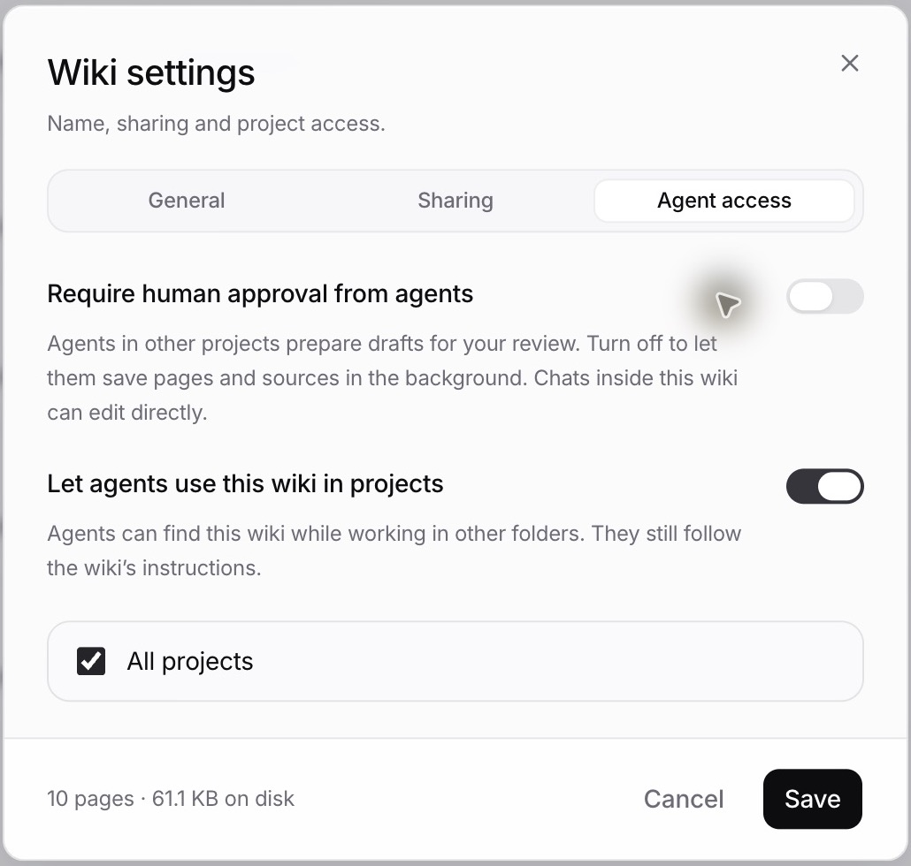
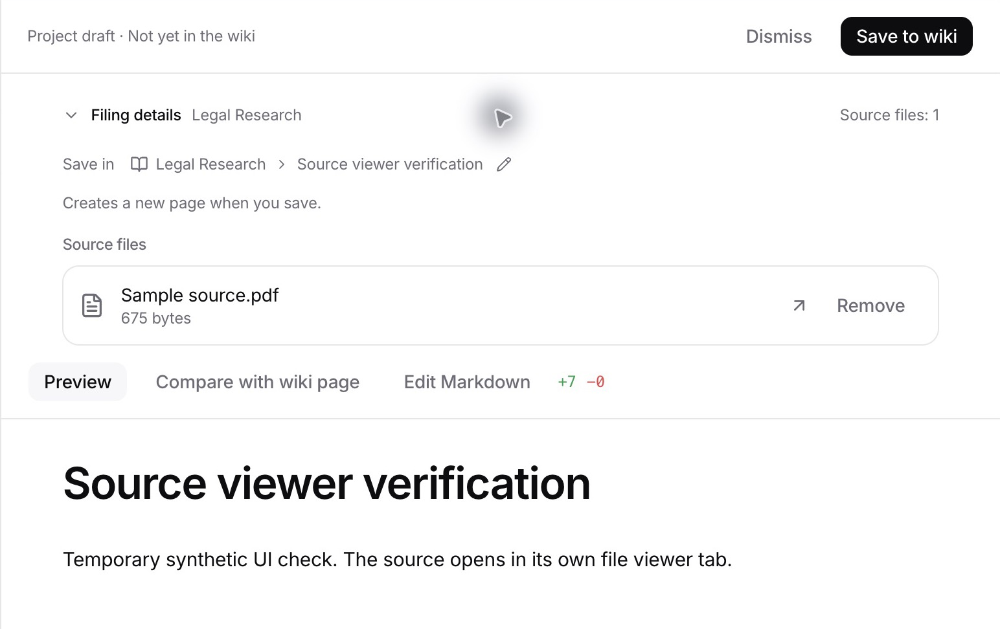
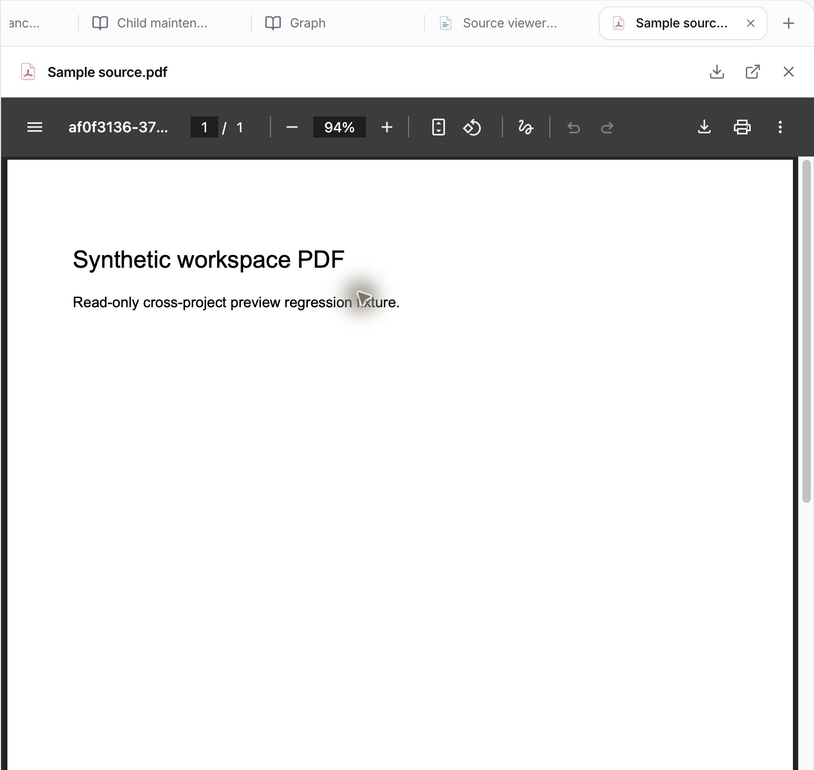

# Wiki research publishing verification

The generated Legal Research wiki defaults to background publication. Other wikis require human approval until their owner changes **Settings > Agent access > Require human approval from agents**. Explicit choices survive upgrades.

Verified in the Electron development app with the existing profile at `http://localhost:5173`:

1. The default research wiki's approval switch is off after upgrade.
2. A synthetic pending contribution displays a compact source-file row.
3. Clicking the row opens the exact staged PDF in a separate viewer tab while keeping the contribution open.
4. Dismissing the synthetic contribution returns the pending count to zero without adding a wiki page.

Automated checks:

- `pnpm dlx bun@latest test src/wiki/suggestions.test.ts src/wiki/store.test.ts src/wiki/write-approval.e2e.test.ts src/wiki/legal-research.test.ts src/opencode-plugins/legalwork-wiki-tools.test.ts` from `apps/server`: 85 pass. Covers approval enforcement, background saves, source collisions, stale revisions, rollback, project access, read-only scope, preserved starter edits and migration defaults. The local Bun 1.3.9 cannot load the installed HTTP transport; this command used Bun 1.4.4 without changing dependencies.
- `pnpm --dir apps/app exec bun test tests/wiki-suggestions.test.ts tests/wiki-markdown-syntax.test.ts tests/wiki-page-heading.test.ts`: 26 pass. Covers source tabs, restored layouts, legacy marker rendering, link generation and preservation of older source references.
- `pnpm --dir apps/server build`, `pnpm typecheck`, `pnpm --dir apps/server typecheck`, `pnpm docs:generate`, and `pnpm docs:check`: pass.

These tests do not make live legal-research model calls. The updated bundled skill and exact known starter versions are covered by prompt/migration assertions. Custom starter instructions remain unchanged.
