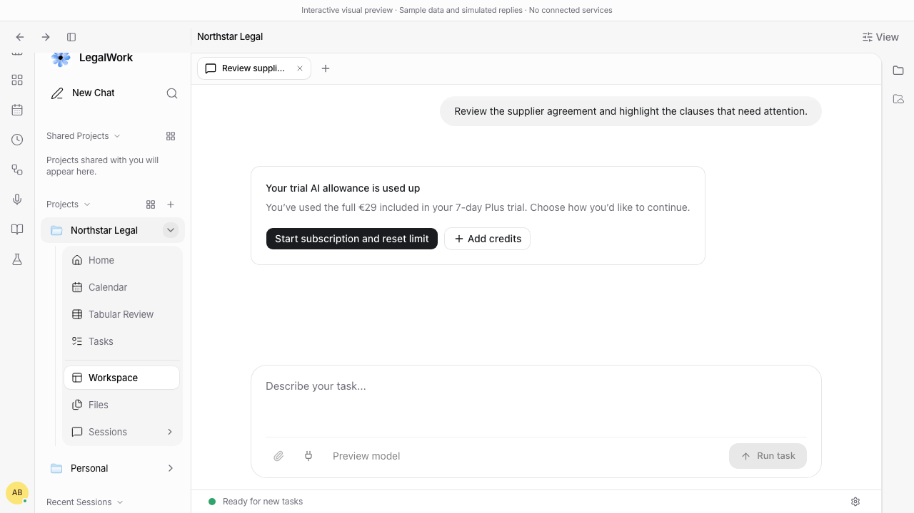
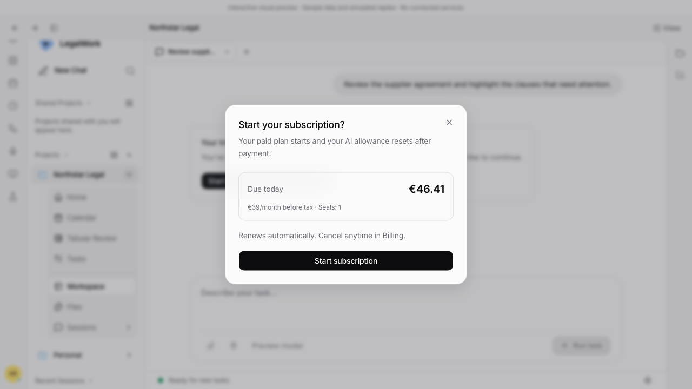
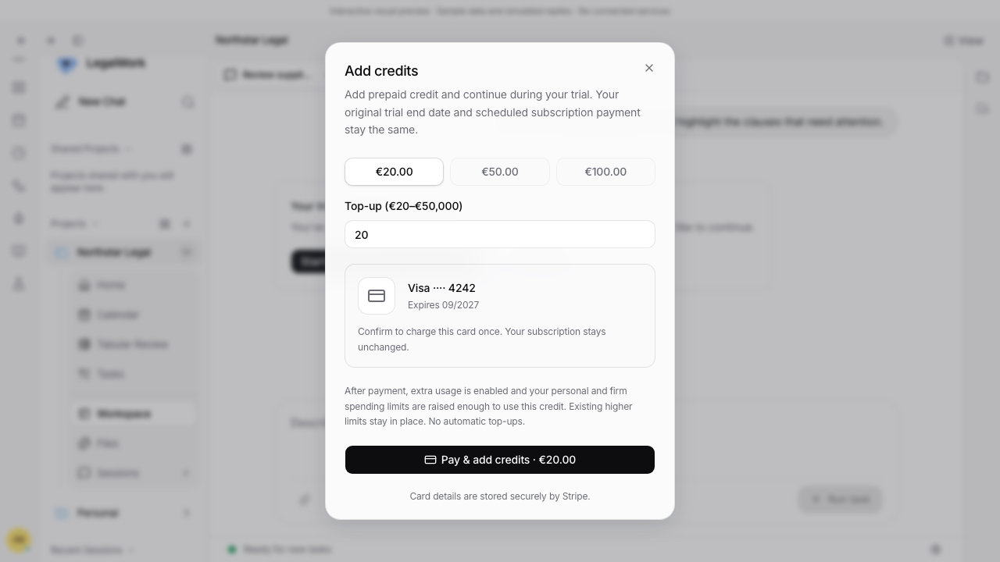
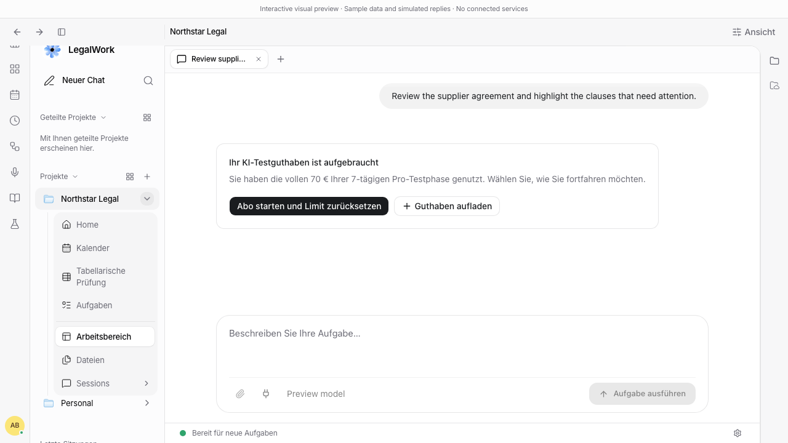

# Seven-day trial recovery in chat

The trial includes €29 on Plus or €70 on Pro for the entire seven days. Paid monthly allowances remain €30/€70. The platform controls enforcement and payments (model-api PR #102).

When trial usage is exhausted, admins see **Start subscription** and **Add credits**. Starting the subscription shows the full initial payment and recurring seat price, including the annual total for yearly billing. Failed or unverified payments retain the original trial. A verified trial top-up enables the permissions explicitly shown in its confirmation and preserves the trial end date. Members can request admin help.

## Reproduce the preview

Run `pnpm --filter @legalwork/app dev:web --host 127.0.0.1 --port 4467 --strictPort`.

- `/session-preview.html?trial=exhausted&limit=plus&lang=en&theme=light`
- `/session-preview.html?trial=exhausted&limit=pro&lang=de&theme=light`
- Add `&annual=1` to inspect the full annual payment.
- Add `&role=member` to inspect the admin-request flow.

Click Start subscription and reset limit, then Start subscription to confirm its sample payment, then Back to chat. Reload and click Add credits to confirm a sample €20 top-up. Both paths restore usable AI usage. These are local fixtures with simulated payment results and no connected services; they never initiate live charges. The preview currently logs missing-service requests to `legalwork-preview.invalid` from unrelated background panels. No application exception was observed in these flows.

## Evidence

Screenshots were captured from the running chat preview. No packaged desktop video or live Stripe payment was recorded; payment decline, verification, replay, annual pricing and permissions are covered by the platform integration tests with mocked Stripe.
