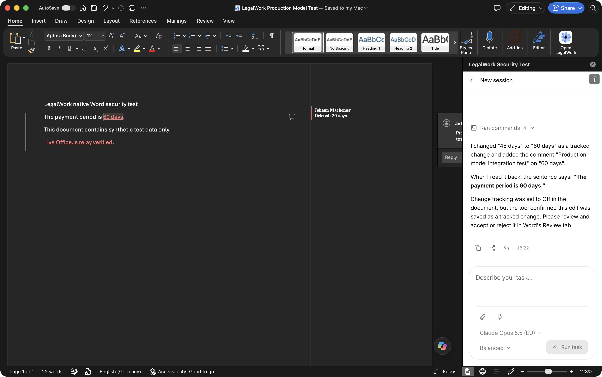

# Office connection verification — 25 October 2026

## Automatic connection

The PR branch was built and run in real Electron 43.7.5 on macOS, with an isolated desktop profile and the Office HTTPS listener on localhost. The updated flow has no code screen or desktop approval dialog. Installation supplies a separate Office credential through a private local manifest.

A native integration probe used Node HTTPS with the local CA explicitly trusted; certificate verification stayed enabled. It verified:

- Public bootstrap contains no application, host, or installation credential.
- Anonymous session creation returns 401.
- The installed Office credential creates a session automatically, and that session can call `/whoami`.
- The Office credential cannot access host-only environment settings.
- After stopping and restarting the isolated Electron app, the previous Office credential still works and the automatic exchange returns the same credential.

The regression tests also cover cross-origin and rebinding requests, credential rotation, concurrent first starts, private file permissions, automatic migration from the previous app credential, and removal of the retired pairing endpoints. An API integration test runs with manual approvals configured to deny and confirms the connection invokes no approval callback. The shell test executes its JavaScript to verify that it captures and removes the fragment before handing off to the app.

Commands:

```sh
pnpm --filter legalwork-server exec bun test src/office-connection.test.ts src/word-addin-shell.test.ts src/word-addin.e2e.test.ts src/tokens.test.ts
node --test apps/desktop/electron/office-addin-platform.test.mjs apps/desktop/electron/office-addin-cert-web.test.mjs apps/desktop/electron/runtime.test.mjs apps/desktop/electron/host-approvals.test.mjs
pnpm --filter legalwork-server build
pnpm --filter @legalwork/app typecheck
pnpm --filter @legalwork/app build:word-addin
```

## Word UI verification limit

Microsoft Word 16.114.1 was running and recognized the isolated test add-in. The final updated pane could not be exercised end to end: native UI automation returned `noWindowsAvailable` for coordinate actions and subsequently `timeoutReached` when reconnecting to Word. The Electron HTTPS/API checks above passed, but do not establish that Word's current webview completes the new manifest handoff.

To finish that check manually:

1. Build and start this PR's desktop app.
2. Enable the Word add-in in LegalWork, then open it from Word's Add-ins menu. An already enabled installation refreshes its manifest automatically; restart Word if it caches the previous manifest.
3. Confirm the pane connects without a code or an approval dialog, and that document read/edit tools work.
4. Restart LegalWork, then reopen the pane. Confirm it reconnects without prompting.
5. For an existing pane with a previous application credential, confirm it migrates automatically and still connects.

## Earlier production model regression check

Before the automatic connection revision, a Word tool run completed in real Microsoft Word 16.114.1 and Electron 43.7.5, connected to `https://platform.eigenweltlabs.com`. In a synthetic document, the production model read text, changed the payment period from 45 to 60 days as a tracked change, added a comment, and searched for the resulting text. Saving and reading the document again verified that the edit and comment persisted.

All four tools completed: `word_read_document`, `word_replace_text`, `word_add_comment`, and `word_search`. Claude Opus 5.5 EU completed the run after the initial Gemini request encountered a provider capacity response.

This screenshot is evidence of that earlier document-tool run, not of the new automatic connection handoff.


