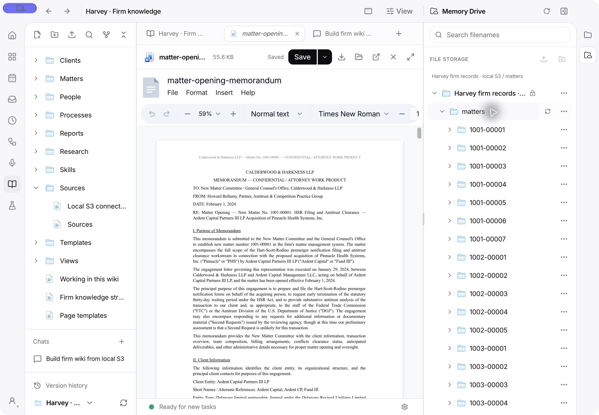

# Firm wiki from local S3

The law firm starter includes four editable workspace skills: setup, capture, use and maintain. Setup adapts the wiki in a conversation and imports selected sources only when requested. The global `workflow-firm-knowledge` entry is a thin launcher that discovers the selected wiki's own guidance.

## Source and local storage

The complete [Harvey LAB firm-knowledge subtree](https://github.com/harveyai/harvey-labs/tree/a15650fe74bb20b86f160aaabdad75b87a91b6e8/tasks/firm-knowledge) is mirrored at commit `a15650fe74bb20b86f160aaabdad75b87a91b6e8`:

- 9,538 original files, 520,346,042 bytes, with relative paths preserved.
- `dms/`: 9,288 source records in 266 matter folders.
- `tasks/`: 250 benchmark task definitions.
- `_provenance/`: the upstream MIT license, README and pinned Git tree manifest.

Every downloaded file was checked against its Git blob SHA and size. Uploads used Content-MD5; a complete paginated S3 listing matched every original key, size and MD5 ETag. Empty folders are not separate Git objects; the folder hierarchy is represented by object-key prefixes.

A dedicated MinIO container uses the already-installed image `quay.io/minio/minio:RELEASE.2025-09-07T16-13-09Z`. It is independent of the existing LegalWork walk/demo containers:

| Item | Value |
| --- | --- |
| Container and persistent volume | `legalwork-wiki-harvey-s3` |
| S3 endpoint | `http://127.0.0.1:3195` |
| Console | `http://127.0.0.1:3196` |
| Bucket | `harvey-firm-knowledge-a15650fe` |
| Electron wiki | Harvey · Firm knowledge |
| Connection | Harvey firm records · local S3 |
| Connection prefix | `dms` |
| Source access | Read-only |

The bucket preserves the entire subtree, but the app's source connection exposes only `dms`. Task questions and grading rubrics are therefore not available through the source connection. This prevents answer leakage into an evidence-based knowledge import.

The local corpus and manifests live in `~/.local/share/legalwork/harvey-firm-knowledge/`. `s3-manifest.json` records verification, `demo.json` records the wiki/connection/chat IDs, and `run-prompt.txt` preserves the submitted prompt. Local credentials are in a mode-0600 file outside the repository and are not shown to agents or committed. The Electron connection was created and tested through the normal server storage API.

Restart the retained local service with:

```sh
docker start legalwork-wiki-harvey-s3
```

To verify and re-upload the retained corpus using the existing dependencies:

```sh
pnpm --filter legalwork-server exec bun scripts/upload-harvey-firm-s3.ts "$HOME/.local/share/legalwork/harvey-firm-knowledge"
```

This intentionally does not remove or replace other containers, volumes or buckets.

## First visible run

Open Wiki in the global navigation, choose **Harvey · Firm knowledge**, and use the tab plus button to start a chat. Memory Drive contains the source tree. The chat's working directory is the wiki root. The earlier **Build firm wiki from local S3** chat is also retained.

The submitted first-run prompt asks the agent to inventory the connection, review the first three matter folders, save supported client/matter pages incrementally, create relations through indexed fields, extract useful reusable knowledge, and save a live dashboard and frozen report. It must retain a checkpoint for the remaining scope. It cannot claim that inventorying 9,288 files means reviewing their content.

For a new chat in this wiki:

> Set up this wiki from Harvey firm records · local S3. Start with three matters so I can inspect the result.

After inspecting that batch:

> Continue the import from where you stopped.

The local setup skill supplies the source checks, coverage ledger, indexed relations and dashboard procedure. The user does not need to specify tool names. A new wiki needs its own source connection; choosing the law firm starter does not copy credentials or another workspace's access.

## What was actually verified

- The running Electron server lists all 266 matter folders across three pages from the connected S3 bucket.
- A source matter-opening memorandum downloads byte-for-byte identically to the pinned Git file and opens in the app's existing Word tab. The source connection is read-only; editable working copies remain local.
- A new `Sources/Connection check.md` written on disk appears in the open native wiki tree without clicking refresh. This is a setup verification note, explicitly not agent-generated imported knowledge.
- Wiki tree revision polling now runs every two seconds and invalidates saved-view data and lists along with the tree. Automated tests cover external batch writes, binary files, nested folders, indexed fields and relation edges.
- The wiki's own tabs, expanded folders and Memory Drive state survive an Electron restart. A discovered stale-workspace selection bug was fixed so a newly created wiki does not borrow another workspace's tabs or agent directory.
- New law firm dashboards are saved in `Dashboards/`, and new reports in `Reports/`. Existing files keep their locations and remain readable and editable, including older reports in `Views/`.



## Live model blocker

The real import was submitted on 11 October 2026 at 19:44 UTC, using the already connected `openai/gpt-5.6-terra-pro`. The provider returned `AI_APICallError: You have no credits remaining. Add credits to continue using the API` before any tool call. Input/output tokens were both zero.

No agent-populated client/matter pages, generated dashboard or generated report are claimed for this run. The source mirror, connection and chat remain ready. On 12 October, the untouched starter was refreshed to the four local workspace skills and new layout, with the earlier starter backed up and retired files recoverable through wiki trash. The source verification note and prepared chat were preserved. No import checkpoint or client/matter records exist. The earlier chat retains its provider error; a new chat can use the currently selected model. Resume only when ready to run the extraction. No paid service, new provider, billing change, substitute scripted extraction or forged tool result was used to bypass the failure.
