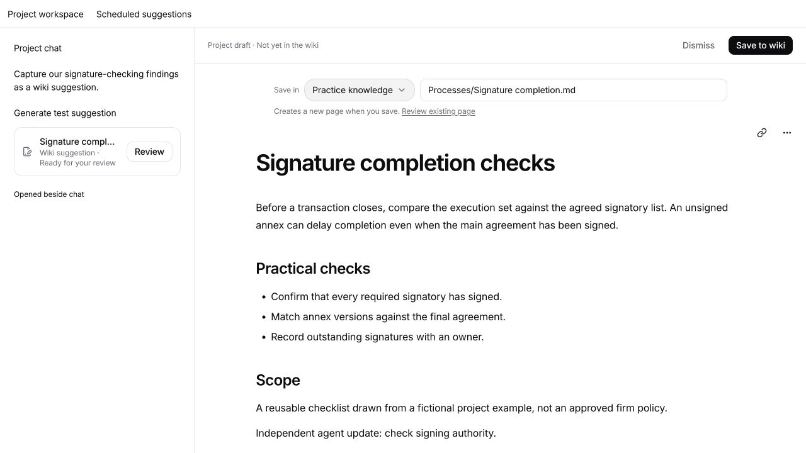
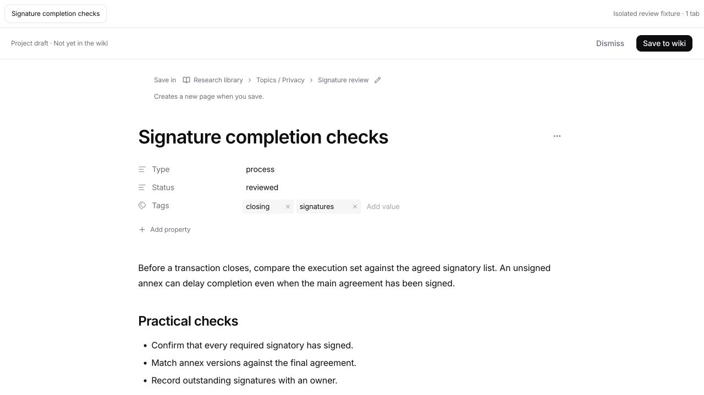
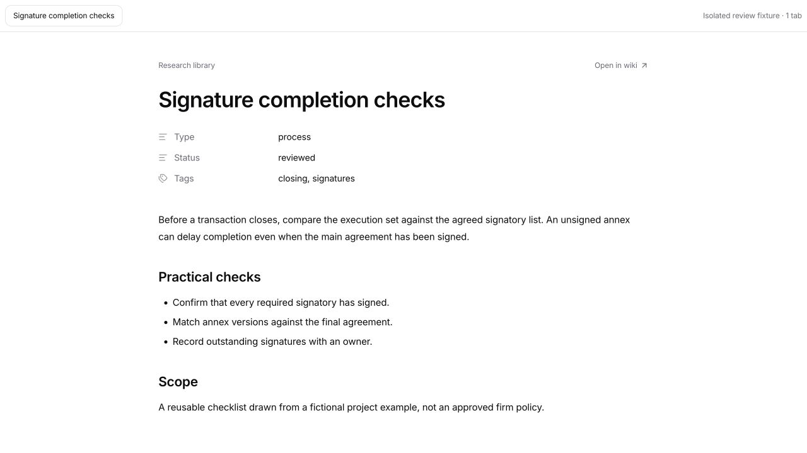

# Project wiki suggestions

Project agents can search and read every wiki currently accessible to their project. Search uses the full indexed page text and metadata, returns relevance-ranked passages, supports quoted phrases and prefix matching, and offers all-word or any-word matching with pagination across wikis.

## Contribution flow

1. Ask a project agent to turn a finding into a wiki suggestion.
2. The agent discovers accessible wikis, searches for existing knowledge, and inspects plausible destinations. `wiki_guidance` returns actual folders, example pages, root instructions and inherited regional `AGENTS.md` files. After reading the relevant procedures and representative pages, it explains the specific knowledge, destination and whether to add or update.
3. `wiki_suggest` creates a normal Markdown draft under the originating project's `.legalwork/tmp/wiki-suggestions/<id>/draft.md`. The adjacent metadata records its proposed wiki, path, revision and review status.
4. A review tab opens beside the chat. Both user edits and requested agent edits update only the project draft. Properties render beneath the title. The user can edit content and metadata, choose an existing folder in a wiki, and rename the file through a location picker. Switching wiki resets folder browsing to that wiki's root. The server validates the selected folder when staging, editing and saving; existing page collisions require a reviewed revision.
5. **Save to wiki** publishes the exact reviewed draft and replaces it in the same tab and pane with the saved read-only wiki page. Back/Forward treats this as the same navigation stop. **Dismiss** leaves the wiki unchanged and retains the decision so future reviews can avoid repeating it.

Project agent credentials cannot call either review action or write pages, properties or views directly into another wiki. Dedicated wiki sessions keep direct access to their own wiki. Fresh access and page revisions are checked at publication; concurrent wiki changes never silently overwrite a colleague's work. Concurrent draft edits open a comparison while retaining the user's buffer.

Suggestions require an explicit user request. An explicitly added weekly review schedule authorizes suggestions for that review; ordinary project activity does not.

## Choosing worthwhile contributions

The agent must identify a concrete future question or decision the information helps, check what it adds to existing knowledge, and choose the smallest useful contribution. Useful organization and relationship facts should remain specific when the destination audience is authorized. General lessons may need anonymization; that is not a reason to replace entity facts with a generic checklist.

Processes merit a page when they capture a non-obvious dependency, decision, handoff, exception or organization-specific practice. Repetition alone does not justify documenting an obvious checking step. Prefer an update to an existing subject over several thin pages. Both requested captures and weekly reviews may correctly produce no suggestions. An explicit request for a specific record or checklist takes precedence.

The same default selection guidance reaches project agents through the wiki tool instructions and new firm/blank wikis through their editable structure. Capture procedures and the weekly starter follow it. Existing wiki files, drafts, customized workflows and saved schedules are not rewritten.

## Weekly review

Scheduled tasks offers **Weekly wiki knowledge review** as one of its four starter cards. It preselects all-project access and a weekly Friday schedule. The user chooses the project that will hold the drafts, adjusts the instructions or schedule, and saves the task. Merely displaying the card creates nothing.

The review reads the past seven days of project chats, compares findings against accessible wikis and existing proposals, anonymizes reusable knowledge, and prepares drafts for later review. It does not copy client documents or publish changes. Existing project/wiki access restrictions still apply. The server records the schedule editor's wiki authority; collaborator edits cannot retain a prior owner's private-wiki grant.

## Validation (14 October 2026)

- `pnpm --dir apps/server exec bun test src/wiki src/opencode-plugins/legalwork-wiki-tools.test.ts src/opencode-plugins/legalwork-wiki-tools.e2e.test.ts src/opencode-plugins/legalwork-scheduled-task-tools.test.ts src/scheduled-tasks`: 179 passed, 2 optional tests skipped, 0 failed. The skipped tests require an external model engine or real sandbox VM. HTTP tests cover child credentials, direct-write rejection, staging, exact revisions, revocation, human Save/Dismiss and shared-wiki synchronization.
- `pnpm --dir apps/app exec bun test tests/wiki-suggestions.test.ts tests/wiki-drafts.test.tsx tests/wiki-editor-outline.test.ts tests/wiki-tabs.test.ts tests/scheduled-task-templates.test.ts tests/scheduled-task-card.test.tsx tests/markdown-block-editor.test.ts`: 40 passed, 0 failed.
- App and server typechecks and builds passed. App build reports its existing large-chunk warning.
- Browser UI QA used the real editor, review components and server in an isolated fixture. A simulated tool completion opened the draft beside chat. Manual text edits and destination changes stayed outside both fixture wikis until Save; agent file edits refreshed in the editor; Dismiss wrote nothing; concurrent edits blocked publication and offered explicit conflict resolution.
- Native Electron was restarted and verified. The weekly review card opens a dialog with All projects, Weekly and the local Friday afternoon schedule. Cancel left the schedule list empty.

No user wiki content was changed and no real scheduled task was created. This change has not had a full model-driven weekly review run.

The screenshot shows the isolated review fixture, including a simulated project chat on the left and the production review component on the right:

## Destination and saved-tab follow-up

Reviewed the actual Eigenweltlabs Office session: wiki names were available through search, but the agent did not inspect candidate structures before asking for a destination. It read Northstar's legacy Instructions.md and Structure.md (that wiki has no AGENTS.md), plus Templates.md. It did not inspect regional folders or representative destination pages. The contribution instructions now explicitly require that preparation. Simple factual lookup still uses search directly.

The focused app checks passed (27 tests), the broader wiki/server checks passed (145 tests, with one optional real-VM test skipped), and app/server builds and app typechecking passed.

Verification used an isolated project and two fixture wikis. In the production review component, a property was changed from draft to reviewed, the destination was switched to another wiki and a nested existing folder, and Save replaced the draft with the saved read-only page in its original tab. The file retained the edited frontmatter; the original wiki received no page. API tests also reject a path copied from a different wiki, recheck folders at Save, and preserve draft/wiki revision conflicts. No real user wiki or pending draft was modified. The updated agent decision-making instructions have not yet been tested in a fresh model-driven contribution run.

## Selection follow-up (14 October 2026)

Four fresh calls to the app's configured `openai/gpt-6.1-sol-fast` model used the updated wiki tool instructions, capture procedure, synthetic source evidence and a supplied custom studio-wiki snapshot. Tools were disabled. The calls evaluated selection and proposed prose, not discovery or publication. Disposable test sessions were removed afterward.

| Evidence and existing knowledge | Observed selection |
| --- | --- |
| Desk supplier and separate mail-service company, supported prices and notice terms, an existing partner page, plus routine contract-review notes | One update to the partner page retaining the specific facts. No generic process page. |
| Routine quotation checks, a typo correction and a changed meeting time, with no substantive finding | No draft. |
| Three incidents establish invoice duplication during credential rotation, with an adopted pause/reconcile/resume procedure and an escalation condition | One focused process page preserving the hidden dependency, sequence and exception. |
| A reread confirms facts already fully recorded in the partner page | No draft. |

All four selections matched the expected judgment. These examples are a behavioral smoke check, not a guarantee of future editorial quality. No user wiki content or pending suggestion was changed.

Validation: `pnpm --dir apps/server exec bun test src/wiki/templates.test.ts src/opencode-plugins/legalwork-wiki-tools.test.ts src/opencode-plugins/legalwork-wiki-tools.e2e.test.ts` passed 28 tests. App typechecking, server build and the six scheduled-template tests passed. The bundled workflow was regenerated from its canonical source; all 12 global-skill tests passed, including a check that installed defaults match that source.
